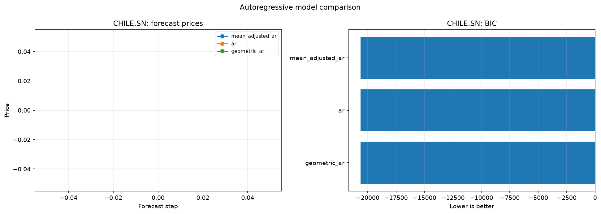

# Autoregressive Market Data Study

**Summary:** AR study for 2 ticker(s), horizon 10; 0 model/ticker comparison(s) have realized values.
**Companies:** COLBUN.SN, CHILE.SN  
**Origin:** latest stored observation  
**Horizon:** 10  
**Selection criterion:** bic

## Forecasts

| ticker | model | step | timestamp | predicted_return | predicted_price | actual_price |
| --- | --- | --- | --- | --- | --- | --- |
| CHILE.SN | ar_1 | 1 | 2026-11-26 00:00:00+00:00 | 0.0005980854891001653 | 189.3231704732753 |  |
| CHILE.SN | ar_1 | 2 | 2026-11-27 00:00:00+00:00 | 0.0007120121379443155 | 189.45797086864636 |  |
| CHILE.SN | ar_1 | 3 | 2026-11-30 00:00:00+00:00 | 0.0007087410550860113 | 189.59224751081427 |  |
| CHILE.SN | ar_1 | 4 | 2026-12-01 00:00:00+00:00 | 0.0007088349750176028 | 189.72663712684212 |  |
| CHILE.SN | ar_1 | 5 | 2026-12-02 00:00:00+00:00 | 0.0007088322783712834 | 189.86112149130446 |  |
| CHILE.SN | ar_1 | 6 | 2026-12-03 00:00:00+00:00 | 0.0007088323557978876 | 189.9957011973256 |  |
| CHILE.SN | ar_1 | 7 | 2026-12-04 00:00:00+00:00 | 0.0007088323535748008 | 190.1303762973744 |  |
| CHILE.SN | ar_1 | 8 | 2026-12-07 00:00:00+00:00 | 0.0007088323536386305 | 190.26514685950346 |  |
| CHILE.SN | ar_1 | 9 | 2026-12-08 00:00:00+00:00 | 0.0007088323536367977 | 190.40001295136693 |  |
| CHILE.SN | ar_1 | 10 | 2026-12-09 00:00:00+00:00 | 0.0007088323536368504 | 190.53497464067974 |  |
| CHILE.SN | ar_10 | 1 | 2026-11-26 00:00:00+00:00 | 0.001082403579080662 | 189.41480830233215 |  |
| CHILE.SN | ar_10 | 2 | 2026-11-27 00:00:00+00:00 | 0.00036751156812430633 | 189.4844204355573 |  |
| CHILE.SN | ar_10 | 3 | 2026-11-30 00:00:00+00:00 | 0.0028083935705388455 | 190.01656726362577 |  |
| CHILE.SN | ar_10 | 4 | 2026-12-01 00:00:00+00:00 | 0.0019096765917811858 | 190.37943745417974 |  |
| CHILE.SN | ar_10 | 5 | 2026-12-02 00:00:00+00:00 | 0.0016922822541939617 | 190.7016131977469 |  |
| CHILE.SN | ar_10 | 6 | 2026-12-03 00:00:00+00:00 | 0.0011612861066815734 | 190.92307233167523 |  |
| CHILE.SN | ar_10 | 7 | 2026-12-04 00:00:00+00:00 | 0.0012525889495882347 | 191.16222046229933 |  |
| CHILE.SN | ar_10 | 8 | 2026-12-07 00:00:00+00:00 | 0.0003531792213436702 | 191.22973498647252 |  |
| CHILE.SN | ar_10 | 9 | 2026-12-08 00:00:00+00:00 | 3.926405011272279e-05 | 191.2372434403701 |  |
| CHILE.SN | ar_10 | 10 | 2026-12-09 00:00:00+00:00 | 0.00039441029857611087 | 191.31266937865425 |  |
| CHILE.SN | ar_2 | 1 | 2026-11-26 00:00:00+00:00 | 0.0003119422066234208 | 189.26902930087672 |  |
| CHILE.SN | ar_2 | 2 | 2026-11-27 00:00:00+00:00 | 0.0004992443553997372 | 189.36352079540717 |  |
| CHILE.SN | ar_2 | 3 | 2026-11-30 00:00:00+00:00 | 0.0007398883262080595 | 189.50362865385333 |  |
| CHILE.SN | ar_2 | 4 | 2026-12-01 00:00:00+00:00 | 0.0007216767185708309 | 189.64038901073752 |  |
| CHILE.SN | ar_2 | 5 | 2026-12-02 00:00:00+00:00 | 0.0007082969129533171 | 189.7747107128451 |  |
| CHILE.SN | ar_2 | 6 | 2026-12-03 00:00:00+00:00 | 0.0007097610831996117 | 189.90940541708454 |  |
| CHILE.SN | ar_2 | 7 | 2026-12-04 00:00:00+00:00 | 0.0007104911810589268 | 190.0443343748335 |  |
| CHILE.SN | ar_2 | 8 | 2026-12-07 00:00:00+00:00 | 0.0007103840410093221 | 190.17933883705766 |  |
| CHILE.SN | ar_2 | 9 | 2026-12-08 00:00:00+00:00 | 0.0007103450353466651 | 190.3144317862261 |  |
| CHILE.SN | ar_2 | 10 | 2026-12-09 00:00:00+00:00 | 0.000710352434046863 | 190.4496221060797 |  |
| CHILE.SN | ar_3 | 1 | 2026-11-26 00:00:00+00:00 | 0.0003327015188816457 | 189.2729571704885 |  |
| CHILE.SN | ar_3 | 2 | 2026-11-27 00:00:00+00:00 | 0.00020418093652614286 | 189.31160310014263 |  |
| CHILE.SN | ar_3 | 3 | 2026-11-30 00:00:00+00:00 | 0.0005215971636805876 | 189.41034749537147 |  |
| CHILE.SN | ar_3 | 4 | 2026-12-01 00:00:00+00:00 | 0.0007717647888535878 | 189.55652773221294 |  |
| CHILE.SN | ar_3 | 5 | 2026-12-02 00:00:00+00:00 | 0.0007518686347641848 | 189.69904933992962 |  |
| CHILE.SN | ar_3 | 6 | 2026-12-03 00:00:00+00:00 | 0.0007185447483796469 | 189.83535659560545 |  |
| CHILE.SN | ar_3 | 7 | 2026-12-04 00:00:00+00:00 | 0.0007059077410878247 | 189.96936284335845 |  |
| CHILE.SN | ar_3 | 8 | 2026-12-07 00:00:00+00:00 | 0.0007095291351018497 | 190.10415164107255 |  |
| CHILE.SN | ar_3 | 9 | 2026-12-08 00:00:00+00:00 | 0.0007121576636700552 | 190.23953576955924 |  |
| CHILE.SN | ar_3 | 10 | 2026-12-09 00:00:00+00:00 | 0.0007126067548123155 | 190.37510174778097 |  |
| CHILE.SN | ar_4 | 1 | 2026-11-26 00:00:00+00:00 | 0.00025495230869596324 | 189.25824624190724 |  |
| CHILE.SN | ar_4 | 2 | 2026-11-27 00:00:00+00:00 | 0.00020505324940563912 | 189.29705426027596 |  |
| CHILE.SN | ar_4 | 3 | 2026-11-30 00:00:00+00:00 | 0.0005656878592487382 | 189.40413730566257 |  |
| CHILE.SN | ar_4 | 4 | 2026-12-01 00:00:00+00:00 | 0.0008063747090668808 | 189.5568680117785 |  |
| CHILE.SN | ar_4 | 5 | 2026-12-02 00:00:00+00:00 | 0.0007462408454438677 | 189.69832308922332 |  |
| CHILE.SN | ar_4 | 6 | 2026-12-03 00:00:00+00:00 | 0.0007119953383627962 | 189.83338741095807 |  |
| CHILE.SN | ar_4 | 7 | 2026-12-04 00:00:00+00:00 | 0.0007051577071204049 | 189.96724988715968 |  |
| CHILE.SN | ar_4 | 8 | 2026-12-07 00:00:00+00:00 | 0.0007128920936981763 | 190.10267603766582 |  |
| CHILE.SN | ar_4 | 9 | 2026-12-08 00:00:00+00:00 | 0.000714617093738615 | 190.2385266595278 |  |
| CHILE.SN | ar_4 | 10 | 2026-12-09 00:00:00+00:00 | 0.0007142403659963978 | 190.3744026944357 |  |
| CHILE.SN | ar_5 | 1 | 2026-11-26 00:00:00+00:00 | 0.00015977588592976577 | 189.24023791031667 |  |
| CHILE.SN | ar_5 | 2 | 2026-11-27 00:00:00+00:00 | -0.00019390250907624592 | 189.20354375336765 |  |
| CHILE.SN | ar_5 | 3 | 2026-11-30 00:00:00+00:00 | 0.0005716822694798883 | 189.31170806465423 |  |
| CHILE.SN | ar_5 | 4 | 2026-12-01 00:00:00+00:00 | 0.001029096506531487 | 189.50652808206905 |  |
| CHILE.SN | ar_5 | 5 | 2026-12-02 00:00:00+00:00 | 0.0009111373156638092 | 189.67919455136652 |  |
| CHILE.SN | ar_5 | 6 | 2026-12-03 00:00:00+00:00 | 0.0006678561456570037 | 189.80587296715092 |  |
| CHILE.SN | ar_5 | 7 | 2026-12-04 00:00:00+00:00 | 0.0006496034106302061 | 189.92917150958803 |  |
| CHILE.SN | ar_5 | 8 | 2026-12-07 00:00:00+00:00 | 0.0007052930362911672 | 190.06312723164228 |  |
| CHILE.SN | ar_5 | 9 | 2026-12-08 00:00:00+00:00 | 0.0007353988085949746 | 190.20289942896628 |  |
| CHILE.SN | ar_5 | 10 | 2026-12-09 00:00:00+00:00 | 0.0007253725412350903 | 190.34086738947533 |  |
| CHILE.SN | ar_6 | 1 | 2026-11-26 00:00:00+00:00 | 0.0003745663720277914 | 189.28087841963335 |  |
| CHILE.SN | ar_6 | 2 | 2026-11-27 00:00:00+00:00 | -0.00014853151946834814 | 189.25276424315538 |  |
| CHILE.SN | ar_6 | 3 | 2026-11-30 00:00:00+00:00 | 0.0008134100883457568 | 189.40670435083808 |  |
| CHILE.SN | ar_6 | 4 | 2026-12-01 00:00:00+00:00 | 0.0010121807823226857 | 189.59841817702508 |  |
| CHILE.SN | ar_6 | 5 | 2026-12-02 00:00:00+00:00 | 0.0007688823593183931 | 189.74419705611606 |  |
| CHILE.SN | ar_6 | 6 | 2026-12-03 00:00:00+00:00 | 0.000566296309592711 | 189.85164849467557 |  |
| CHILE.SN | ar_6 | 7 | 2026-12-04 00:00:00+00:00 | 0.0006690963033675829 | 189.97867753087158 |  |
| CHILE.SN | ar_6 | 8 | 2026-12-07 00:00:00+00:00 | 0.0007440304445194819 | 190.1200274507641 |  |
| CHILE.SN | ar_6 | 9 | 2026-12-08 00:00:00+00:00 | 0.0007289472508886797 | 190.25861492211322 |  |
| CHILE.SN | ar_6 | 10 | 2026-12-09 00:00:00+00:00 | 0.0007029875562498244 | 190.39236436087282 |  |
| CHILE.SN | ar_7 | 1 | 2026-11-26 00:00:00+00:00 | 0.0004044197189467692 | 189.28652697160433 |  |
| CHILE.SN | ar_7 | 2 | 2026-11-27 00:00:00+00:00 | -0.0001171351115140213 | 189.26435487315942 |  |
| CHILE.SN | ar_7 | 3 | 2026-11-30 00:00:00+00:00 | 0.000828752333187482 | 189.4212081488498 |  |
| CHILE.SN | ar_7 | 4 | 2026-12-01 00:00:00+00:00 | 0.0010408724257821359 | 189.61837146127027 |  |
| CHILE.SN | ar_7 | 5 | 2026-12-02 00:00:00+00:00 | 0.0007692090891341765 | 189.7642276360651 |  |
| CHILE.SN | ar_7 | 6 | 2026-12-03 00:00:00+00:00 | 0.0005560360665293752 | 189.86974339076784 |  |
| CHILE.SN | ar_7 | 7 | 2026-12-04 00:00:00+00:00 | 0.0006645427462570186 | 189.99591995147185 |  |
| CHILE.SN | ar_7 | 8 | 2026-12-07 00:00:00+00:00 | 0.0007522281176554224 | 190.13884022469918 |  |
| CHILE.SN | ar_7 | 9 | 2026-12-08 00:00:00+00:00 | 0.0007385405631725134 | 190.2792654708397 |  |
| CHILE.SN | ar_7 | 10 | 2026-12-09 00:00:00+00:00 | 0.0007073967420333252 | 190.41386840331026 |  |
| CHILE.SN | ar_8 | 1 | 2026-11-26 00:00:00+00:00 | 0.0008969813201388961 | 189.37972455547288 |  |
| CHILE.SN | ar_8 | 2 | 2026-11-27 00:00:00+00:00 | 1.936441065465103e-05 | 189.38339178222884 |  |
| CHILE.SN | ar_8 | 3 | 2026-11-30 00:00:00+00:00 | 0.001026452304198538 | 189.57778480110065 |  |
| CHILE.SN | ar_8 | 4 | 2026-12-01 00:00:00+00:00 | 0.0010638380857286636 | 189.77946486878014 |  |
| CHILE.SN | ar_8 | 5 | 2026-12-02 00:00:00+00:00 | 0.001021924970914655 | 189.97340524289638 |  |
| CHILE.SN | ar_8 | 6 | 2026-12-03 00:00:00+00:00 | 0.0005637202759327946 | 190.0804971033198 |  |
| CHILE.SN | ar_8 | 7 | 2026-12-04 00:00:00+00:00 | 0.0005131135519122118 | 190.17802998233773 |  |
| CHILE.SN | ar_8 | 8 | 2026-12-07 00:00:00+00:00 | 0.0006449852267889868 | 190.30069200213615 |  |
| CHILE.SN | ar_8 | 9 | 2026-12-08 00:00:00+00:00 | 0.000743016580407556 | 190.44208857155678 |  |
| CHILE.SN | ar_8 | 10 | 2026-12-09 00:00:00+00:00 | 0.0007485167284585571 | 190.5846376606552 |  |
| CHILE.SN | ar_9 | 1 | 2026-11-26 00:00:00+00:00 | 0.00039604179614356093 | 189.28494178477447 |  |
| CHILE.SN | ar_9 | 2 | 2026-11-27 00:00:00+00:00 | 0.0010789040775383107 | 189.48916208028265 |  |
| CHILE.SN | ar_9 | 3 | 2026-11-30 00:00:00+00:00 | 0.001332496893798057 | 189.74165580016302 |  |
| CHILE.SN | ar_9 | 4 | 2026-12-01 00:00:00+00:00 | 0.0015063209345648032 | 190.02746762845376 |  |
| CHILE.SN | ar_9 | 5 | 2026-12-02 00:00:00+00:00 | 0.0010525101714963026 | 190.2274734709964 |  |
| CHILE.SN | ar_9 | 6 | 2026-12-03 00:00:00+00:00 | 0.0010809759746877676 | 190.43310479954408 |  |
| CHILE.SN | ar_9 | 7 | 2026-12-04 00:00:00+00:00 | 0.0005420363322254144 | 190.53632646120394 |  |
| CHILE.SN | ar_9 | 8 | 2026-12-07 00:00:00+00:00 | 0.0003189213733133672 | 190.59709256810504 |  |
| CHILE.SN | ar_9 | 9 | 2026-12-08 00:00:00+00:00 | 0.0005170912895167563 | 190.69564866447922 |  |
| CHILE.SN | ar_9 | 10 | 2026-12-09 00:00:00+00:00 | 0.0007472288321101348 | 190.83814195131927 |  |
| CHILE.SN | geometric_ar_1 | 1 | 2026-11-26 00:00:00+00:00 | 0.0005981326111714902 | 189.32317938924274 |  |
| CHILE.SN | geometric_ar_1 | 2 | 2026-11-27 00:00:00+00:00 | 0.0007120095644942843 | 189.45797930374837 |  |
| CHILE.SN | geometric_ar_1 | 3 | 2026-11-30 00:00:00+00:00 | 0.0007087412959339201 | 189.59225599752514 |  |
| CHILE.SN | geometric_ar_1 | 4 | 2026-12-01 00:00:00+00:00 | 0.0007088350952416026 | 189.7266456423622 |  |
| CHILE.SN | geometric_ar_1 | 5 | 2026-12-02 00:00:00+00:00 | 0.000708832403201472 | 189.8611300365442 |  |
| CHILE.SN | geometric_ar_1 | 6 | 2026-12-03 00:00:00+00:00 | 0.0007088324804630238 | 189.99570977229152 |  |
| CHILE.SN | geometric_ar_1 | 7 | 2026-12-04 00:00:00+00:00 | 0.0007088324782456172 | 190.13038490210545 |  |
| CHILE.SN | geometric_ar_1 | 8 | 2026-12-07 00:00:00+00:00 | 0.0007088324783092568 | 190.26515549403751 |  |
| CHILE.SN | geometric_ar_1 | 9 | 2026-12-08 00:00:00+00:00 | 0.0007088324783074304 | 190.40002161574188 |  |
| CHILE.SN | geometric_ar_1 | 10 | 2026-12-09 00:00:00+00:00 | 0.0007088324783074828 | 190.53498333493357 |  |
| CHILE.SN | geometric_ar_10 | 1 | 2026-11-26 00:00:00+00:00 | 0.0006178410174636693 | 189.3269084169296 |  |
| CHILE.SN | geometric_ar_10 | 2 | 2026-11-27 00:00:00+00:00 | 0.0007189553681174216 | 189.46302601406504 |  |
| CHILE.SN | geometric_ar_10 | 3 | 2026-11-30 00:00:00+00:00 | 0.000713737867623688 | 189.59825295024584 |  |
| CHILE.SN | geometric_ar_10 | 4 | 2026-12-01 00:00:00+00:00 | 0.0007140070906491646 | 189.73362744722698 |  |
| CHILE.SN | geometric_ar_10 | 5 | 2026-12-02 00:00:00+00:00 | 0.00071399319874105 | 189.86909596679675 |  |
| CHILE.SN | geometric_ar_10 | 6 | 2026-12-03 00:00:00+00:00 | 0.0007139939155635087 | 190.0046613460706 |  |
| CHILE.SN | geometric_ar_10 | 7 | 2026-12-04 00:00:00+00:00 | 0.0007139938785754699 | 190.14032351117248 |  |
| CHILE.SN | geometric_ar_10 | 8 | 2026-12-07 00:00:00+00:00 | 0.0007139938804840526 | 190.27608253859273 |  |
| CHILE.SN | geometric_ar_10 | 9 | 2026-12-08 00:00:00+00:00 | 0.0007139938803855698 | 190.41193849710902 |  |
| CHILE.SN | geometric_ar_10 | 10 | 2026-12-09 00:00:00+00:00 | 0.0007139938803906516 | 190.54789145594927 |  |
| CHILE.SN | geometric_ar_2 | 1 | 2026-11-26 00:00:00+00:00 | 0.0006145748942073138 | 189.3262904337263 |  |
| CHILE.SN | geometric_ar_2 | 2 | 2026-11-27 00:00:00+00:00 | 0.0007162543802320616 | 189.46189621854256 |  |
| CHILE.SN | geometric_ar_2 | 3 | 2026-11-30 00:00:00+00:00 | 0.0007109702457194836 | 189.59659798945154 |  |
| CHILE.SN | geometric_ar_2 | 4 | 2026-12-01 00:00:00+00:00 | 0.0007111753124193796 | 189.73143440926034 |  |
| CHILE.SN | geometric_ar_2 | 5 | 2026-12-02 00:00:00+00:00 | 0.0007111664565415799 | 189.86636504116373 |  |
| CHILE.SN | geometric_ar_2 | 6 | 2026-12-03 00:00:00+00:00 | 0.0007111668234696079 | 190.00139170087377 |  |
| CHILE.SN | geometric_ar_2 | 7 | 2026-12-04 00:00:00+00:00 | 0.0007111668080255606 | 190.1365143841301 |  |
| CHILE.SN | geometric_ar_2 | 8 | 2026-12-07 00:00:00+00:00 | 0.0007111668086717004 | 190.2717331622766 |  |
| CHILE.SN | geometric_ar_2 | 9 | 2026-12-08 00:00:00+00:00 | 0.0007111668086446053 | 190.4070481035249 |  |
| CHILE.SN | geometric_ar_2 | 10 | 2026-12-09 00:00:00+00:00 | 0.0007111668086457405 | 190.54245927626832 |  |
| CHILE.SN | geometric_ar_3 | 1 | 2026-11-26 00:00:00+00:00 | 0.0006165052817718853 | 189.3266556823704 |  |
| CHILE.SN | geometric_ar_3 | 2 | 2026-11-27 00:00:00+00:00 | 0.0007184270101466735 | 189.46267306555333 |  |
| CHILE.SN | geometric_ar_3 | 3 | 2026-11-30 00:00:00+00:00 | 0.000713124542985663 | 189.59778354769605 |  |
| CHILE.SN | geometric_ar_3 | 4 | 2026-12-01 00:00:00+00:00 | 0.0007134007220245277 | 189.73304274337326 |  |
| CHILE.SN | geometric_ar_3 | 5 | 2026-12-02 00:00:00+00:00 | 0.0007133881655254185 | 189.86839605067553 |  |
| CHILE.SN | geometric_ar_3 | 6 | 2026-12-03 00:00:00+00:00 | 0.0007133887718875884 | 190.00384603255438 |  |
| CHILE.SN | geometric_ar_3 | 7 | 2026-12-04 00:00:00+00:00 | 0.0007133887427798558 | 190.13939263739888 |  |
| CHILE.SN | geometric_ar_3 | 8 | 2026-12-07 00:00:00+00:00 | 0.0007133887441672507 | 190.2750359399292 |  |
| CHILE.SN | geometric_ar_3 | 9 | 2026-12-08 00:00:00+00:00 | 0.0007133887441008442 | 190.41077600885214 |  |
| CHILE.SN | geometric_ar_3 | 10 | 2026-12-09 00:00:00+00:00 | 0.0007133887441040202 | 190.54661291321295 |  |
| CHILE.SN | geometric_ar_4 | 1 | 2026-11-26 00:00:00+00:00 | 0.0006175840006362567 | 189.32685978677392 |  |
| CHILE.SN | geometric_ar_4 | 2 | 2026-11-27 00:00:00+00:00 | 0.0007194822472485577 | 189.46307710131782 |  |
| CHILE.SN | geometric_ar_4 | 3 | 2026-11-30 00:00:00+00:00 | 0.0007141836571128457 | 189.5983885346099 |  |
| CHILE.SN | geometric_ar_4 | 4 | 2026-12-01 00:00:00+00:00 | 0.0007144592497693263 | 189.73384885703985 |  |
| CHILE.SN | geometric_ar_4 | 5 | 2026-12-02 00:00:00+00:00 | 0.0007144449072317804 | 189.86940323908524 |  |
| CHILE.SN | geometric_ar_4 | 6 | 2026-12-03 00:00:00+00:00 | 0.0007144456061314658 | 190.00505459996822 |  |
| CHILE.SN | geometric_ar_4 | 7 | 2026-12-04 00:00:00+00:00 | 0.0007144455709993735 | 190.14080286969465 |  |
| CHILE.SN | geometric_ar_4 | 8 | 2026-12-07 00:00:00+00:00 | 0.0007144455727632878 | 190.27664812450655 |  |
| CHILE.SN | geometric_ar_4 | 9 | 2026-12-08 00:00:00+00:00 | 0.0007144455726748386 | 190.41259043334253 |  |
| CHILE.SN | geometric_ar_4 | 10 | 2026-12-09 00:00:00+00:00 | 0.0007144455726792676 | 190.54862986556003 |  |
| CHILE.SN | geometric_ar_5 | 1 | 2026-11-26 00:00:00+00:00 | 0.0006177385309547488 | 189.32688902545655 |  |
| CHILE.SN | geometric_ar_5 | 2 | 2026-11-27 00:00:00+00:00 | 0.000719632859657139 | 189.4631348760159 |  |
| CHILE.SN | geometric_ar_5 | 3 | 2026-11-30 00:00:00+00:00 | 0.0007143343571614524 | 189.59847490267336 |  |
| CHILE.SN | geometric_ar_5 | 4 | 2026-12-01 00:00:00+00:00 | 0.0007146098762053367 | 189.7339638453523 |  |
| CHILE.SN | geometric_ar_5 | 5 | 2026-12-02 00:00:00+00:00 | 0.0007145955474998498 | 189.86954689112568 |  |
| CHILE.SN | geometric_ar_5 | 6 | 2026-12-03 00:00:00+00:00 | 0.0007145962928972396 | 190.00522696546815 |  |
| CHILE.SN | geometric_ar_5 | 7 | 2026-12-04 00:00:00+00:00 | 0.0007145962553562466 | 190.1410039891558 |  |
| CHILE.SN | geometric_ar_5 | 8 | 2026-12-07 00:00:00+00:00 | 0.0007145962572769015 | 190.27687803896134 |  |
| CHILE.SN | geometric_ar_5 | 9 | 2026-12-08 00:00:00+00:00 | 0.0007145962571786642 | 190.41284918383562 |  |
| CHILE.SN | geometric_ar_5 | 10 | 2026-12-09 00:00:00+00:00 | 0.0007145962571836874 | 190.54891749318207 |  |
| CHILE.SN | geometric_ar_6 | 1 | 2026-11-26 00:00:00+00:00 | 0.0006127900512512134 | 189.3259527235786 |  |
| CHILE.SN | geometric_ar_6 | 2 | 2026-11-27 00:00:00+00:00 | 0.0007148130421220039 | 189.4612853837976 |  |
| CHILE.SN | geometric_ar_6 | 3 | 2026-11-30 00:00:00+00:00 | 0.0007095078466408216 | 189.59570965241204 |  |
| CHILE.SN | geometric_ar_6 | 4 | 2026-12-01 00:00:00+00:00 | 0.0007097837167383253 | 189.73028159988675 |  |
| CHILE.SN | geometric_ar_6 | 5 | 2026-12-02 00:00:00+00:00 | 0.0007097693715734883 | 189.86494634262635 |  |
| CHILE.SN | geometric_ar_6 | 6 | 2026-12-03 00:00:00+00:00 | 0.0007097701175666552 | 189.99970680791375 |  |
| CHILE.SN | geometric_ar_6 | 7 | 2026-12-04 00:00:00+00:00 | 0.0007097700787670882 | 190.13456291478053 |  |
| CHILE.SN | geometric_ar_6 | 8 | 2026-12-07 00:00:00+00:00 | 0.0007097700807529144 | 190.2695147388545 |  |
| CHILE.SN | geometric_ar_6 | 9 | 2026-12-08 00:00:00+00:00 | 0.0007097700806504709 | 190.404562347676 |  |
| CHILE.SN | geometric_ar_6 | 10 | 2026-12-09 00:00:00+00:00 | 0.0007097700806557554 | 190.53970580925073 |  |
| CHILE.SN | geometric_ar_7 | 1 | 2026-11-26 00:00:00+00:00 | 0.0006195750369847067 | 189.32723651077478 |  |
| CHILE.SN | geometric_ar_7 | 2 | 2026-11-27 00:00:00+00:00 | 0.0007206446499320194 | 189.46367417085267 |  |
| CHILE.SN | geometric_ar_7 | 3 | 2026-11-30 00:00:00+00:00 | 0.0007154294579045583 | 189.59922206455732 |  |
| CHILE.SN | geometric_ar_7 | 4 | 2026-12-01 00:00:00+00:00 | 0.0007156985618120975 | 189.73491795510964 |  |
| CHILE.SN | geometric_ar_7 | 5 | 2026-12-02 00:00:00+00:00 | 0.0007156846760521187 | 189.87070832840212 |  |
| CHILE.SN | geometric_ar_7 | 6 | 2026-12-03 00:00:00+00:00 | 0.0007156853925553725 | 190.0065960208269 |  |
| CHILE.SN | geometric_ar_7 | 7 | 2026-12-04 00:00:00+00:00 | 0.0007156853555827146 | 190.1425809590631 |  |
| CHILE.SN | geometric_ar_7 | 8 | 2026-12-07 00:00:00+00:00 | 0.0007156853574906974 | 190.278663220091 |  |
| CHILE.SN | geometric_ar_7 | 9 | 2026-12-08 00:00:00+00:00 | 0.0007156853573930202 | 190.41484287318195 |  |
| CHILE.SN | geometric_ar_7 | 10 | 2026-12-09 00:00:00+00:00 | 0.0007156853573980405 | 190.55111998805754 |  |
| CHILE.SN | geometric_ar_8 | 1 | 2026-11-26 00:00:00+00:00 | 0.0006205578054125142 | 189.32742246039564 |  |
| CHILE.SN | geometric_ar_8 | 2 | 2026-11-27 00:00:00+00:00 | 0.000721602062937044 | 189.46404151901362 |  |
| CHILE.SN | geometric_ar_8 | 3 | 2026-11-30 00:00:00+00:00 | 0.0007163881792488468 | 189.59977131875056 |  |
| CHILE.SN | geometric_ar_8 | 4 | 2026-12-01 00:00:00+00:00 | 0.0007166572156471417 | 189.7356493629512 |  |
| CHILE.SN | geometric_ar_8 | 5 | 2026-12-02 00:00:00+00:00 | 0.0007166433333690176 | 189.8716221511696 |  |
| CHILE.SN | geometric_ar_8 | 6 | 2026-12-03 00:00:00+00:00 | 0.0007166440496945262 | 190.0076925193901 |  |
| CHILE.SN | geometric_ar_8 | 7 | 2026-12-04 00:00:00+00:00 | 0.0007166440127321805 | 190.14386039460717 |  |
| CHILE.SN | geometric_ar_8 | 8 | 2026-12-07 00:00:00+00:00 | 0.0007166440146394656 | 190.28012585407942 |  |
| CHILE.SN | geometric_ar_8 | 9 | 2026-12-08 00:00:00+00:00 | 0.0007166440145410448 | 190.41648896735884 |  |
| CHILE.SN | geometric_ar_8 | 10 | 2026-12-09 00:00:00+00:00 | 0.0007166440145461033 | 190.5529498044482 |  |
| CHILE.SN | geometric_ar_9 | 1 | 2026-11-26 00:00:00+00:00 | 0.000616399035455184 | 189.3266355795041 |  |
| CHILE.SN | geometric_ar_9 | 2 | 2026-11-27 00:00:00+00:00 | 0.0007175505892447529 | 189.4624870184239 |  |
| CHILE.SN | geometric_ar_9 | 3 | 2026-11-30 00:00:00+00:00 | 0.0007123311690692148 | 189.59744705329652 |  |
| CHILE.SN | geometric_ar_9 | 4 | 2026-12-01 00:00:00+00:00 | 0.0007126004911502707 | 189.73255428718753 |  |
| CHILE.SN | geometric_ar_9 | 5 | 2026-12-02 00:00:00+00:00 | 0.0007125865941308887 | 189.86775516184278 |  |
| CHILE.SN | geometric_ar_9 | 6 | 2026-12-03 00:00:00+00:00 | 0.000712587311217088 | 190.00305251498037 |  |
| CHILE.SN | geometric_ar_9 | 7 | 2026-12-04 00:00:00+00:00 | 0.0007125872742154412 | 190.13844627226464 |  |
| CHILE.SN | geometric_ar_9 | 8 | 2026-12-07 00:00:00+00:00 | 0.000712587276124725 | 190.27393650978038 |  |
| CHILE.SN | geometric_ar_9 | 9 | 2026-12-08 00:00:00+00:00 | 0.0007125872760262051 | 190.4095232958967 |  |
| CHILE.SN | geometric_ar_9 | 10 | 2026-12-09 00:00:00+00:00 | 0.000712587276031289 | 190.5452066994325 |  |
| CHILE.SN | mean_adjusted_ar_1 | 1 | 2026-11-26 00:00:00+00:00 | 0.000588857783276425 | 189.32142449899445 |  |
| CHILE.SN | mean_adjusted_ar_1 | 2 | 2026-11-27 00:00:00+00:00 | 0.0007030496110342287 | 189.45452685284891 |  |
| CHILE.SN | mean_adjusted_ar_1 | 3 | 2026-11-30 00:00:00+00:00 | 0.0006997709076682707 | 189.5871016190666 |  |
| CHILE.SN | mean_adjusted_ar_1 | 4 | 2026-12-01 00:00:00+00:00 | 0.0006998650465919837 | 189.71978700477445 |  |
| CHILE.SN | mean_adjusted_ar_1 | 5 | 2026-12-02 00:00:00+00:00 | 0.0006998623436524468 | 189.85256473954485 |  |
| CHILE.SN | mean_adjusted_ar_1 | 6 | 2026-12-03 00:00:00+00:00 | 0.0006998624212599002 | 189.9854354151859 |  |
| CHILE.SN | mean_adjusted_ar_1 | 7 | 2026-12-04 00:00:00+00:00 | 0.0006998624190316163 | 190.11839908159632 |  |
| CHILE.SN | mean_adjusted_ar_1 | 8 | 2026-12-07 00:00:00+00:00 | 0.0006998624190955952 | 190.25145580429216 |  |
| CHILE.SN | mean_adjusted_ar_1 | 9 | 2026-12-08 00:00:00+00:00 | 0.0006998624190937583 | 190.38460564838746 |  |
| CHILE.SN | mean_adjusted_ar_1 | 10 | 2026-12-09 00:00:00+00:00 | 0.0006998624190938111 | 190.5178486790548 |  |
| CHILE.SN | mean_adjusted_ar_10 | 1 | 2026-11-26 00:00:00+00:00 | 0.0010629572913195538 | 189.4111288700943 |  |
| CHILE.SN | mean_adjusted_ar_10 | 2 | 2026-11-27 00:00:00+00:00 | 0.00034882689208541357 | 189.47720056550446 |  |
| CHILE.SN | mean_adjusted_ar_10 | 3 | 2026-11-30 00:00:00+00:00 | 0.0027908312204358555 | 190.00599945240347 |  |
| CHILE.SN | mean_adjusted_ar_10 | 4 | 2026-12-01 00:00:00+00:00 | 0.00189322959719301 | 190.365724434211 |  |
| CHILE.SN | mean_adjusted_ar_10 | 5 | 2026-12-02 00:00:00+00:00 | 0.0016755475175272514 | 190.684691251209 |  |
| CHILE.SN | mean_adjusted_ar_10 | 6 | 2026-12-03 00:00:00+00:00 | 0.0011436626812823029 | 190.90277021648487 |  |
| CHILE.SN | mean_adjusted_ar_10 | 7 | 2026-12-04 00:00:00+00:00 | 0.0012355875505629154 | 191.13864730273235 |  |
| CHILE.SN | mean_adjusted_ar_10 | 8 | 2026-12-07 00:00:00+00:00 | 0.00033649616825810177 | 191.20296472515577 |  |
| CHILE.SN | mean_adjusted_ar_10 | 9 | 2026-12-08 00:00:00+00:00 | 2.3215391359735675e-05 | 191.207403576811 |  |
| CHILE.SN | mean_adjusted_ar_10 | 10 | 2026-12-09 00:00:00+00:00 | 0.0003793360811617971 | 191.27993544397293 |  |
| CHILE.SN | mean_adjusted_ar_2 | 1 | 2026-11-26 00:00:00+00:00 | 0.00030052267435428347 | 189.26686861109943 |  |
| CHILE.SN | mean_adjusted_ar_2 | 2 | 2026-11-27 00:00:00+00:00 | 0.00048817291300109274 | 189.3592635696839 |  |
| CHILE.SN | mean_adjusted_ar_2 | 3 | 2026-11-30 00:00:00+00:00 | 0.0007294683189988599 | 189.49739515336694 |  |
| CHILE.SN | mean_adjusted_ar_2 | 4 | 2026-12-01 00:00:00+00:00 | 0.0007112166737100348 | 189.63216886042463 |  |
| CHILE.SN | mean_adjusted_ar_2 | 5 | 2026-12-02 00:00:00+00:00 | 0.0006978003217030506 | 189.76449424886067 |  |
| CHILE.SN | mean_adjusted_ar_2 | 6 | 2026-12-03 00:00:00+00:00 | 0.0006992679271489019 | 189.89719047340054 |  |
| CHILE.SN | mean_adjusted_ar_2 | 7 | 2026-12-04 00:00:00+00:00 | 0.0007000000390627921 | 190.03011851414985 |  |
| CHILE.SN | mean_adjusted_ar_2 | 8 | 2026-12-07 00:00:00+00:00 | 0.0006998926384644283 | 190.16311919518444 |  |
| CHILE.SN | mean_adjusted_ar_2 | 9 | 2026-12-08 00:00:00+00:00 | 0.0006998535239797855 | 190.29620552428415 |  |
| CHILE.SN | mean_adjusted_ar_2 | 10 | 2026-12-09 00:00:00+00:00 | 0.0006998609411024432 | 190.4293864057706 |  |
| CHILE.SN | mean_adjusted_ar_3 | 1 | 2026-11-26 00:00:00+00:00 | 0.0003185996507185442 | 189.27028895591866 |  |
| CHILE.SN | mean_adjusted_ar_3 | 2 | 2026-11-27 00:00:00+00:00 | 0.00019055693791247862 | 189.30635572261994 |  |
| CHILE.SN | mean_adjusted_ar_3 | 3 | 2026-11-30 00:00:00+00:00 | 0.0005088016308805083 | 189.40267510514767 |  |
| CHILE.SN | mean_adjusted_ar_3 | 4 | 2026-12-01 00:00:00+00:00 | 0.000759756806512392 | 189.54657507673045 |  |
| CHILE.SN | mean_adjusted_ar_3 | 5 | 2026-12-02 00:00:00+00:00 | 0.00073975573297423 | 189.68679324230908 |  |
| CHILE.SN | mean_adjusted_ar_3 | 6 | 2026-12-03 00:00:00+00:00 | 0.0007063386314951446 | 189.82077635226057 |  |
| CHILE.SN | mean_adjusted_ar_3 | 7 | 2026-12-04 00:00:00+00:00 | 0.0006936639184432628 | 189.952448175787 |  |
| CHILE.SN | mean_adjusted_ar_3 | 8 | 2026-12-07 00:00:00+00:00 | 0.0006972984548308924 | 190.0849017243913 |  |
| CHILE.SN | mean_adjusted_ar_3 | 9 | 2026-12-08 00:00:00+00:00 | 0.0006999343771072337 | 190.21794868167726 |  |
| CHILE.SN | mean_adjusted_ar_3 | 10 | 2026-12-09 00:00:00+00:00 | 0.0007003846878663234 | 190.35117442029124 |  |
| CHILE.SN | mean_adjusted_ar_4 | 1 | 2026-11-26 00:00:00+00:00 | 0.00023908225212320442 | 189.2552434683966 |  |
| CHILE.SN | mean_adjusted_ar_4 | 2 | 2026-11-27 00:00:00+00:00 | 0.00018971838988842858 | 189.29114866846538 |  |
| CHILE.SN | mean_adjusted_ar_4 | 3 | 2026-11-30 00:00:00+00:00 | 0.0005512785532992895 | 189.39550081905568 |  |
| CHILE.SN | mean_adjusted_ar_4 | 4 | 2026-12-01 00:00:00+00:00 | 0.000792848523974214 | 189.54566276232745 |  |
| CHILE.SN | mean_adjusted_ar_4 | 5 | 2026-12-02 00:00:00+00:00 | 0.0007324740816619554 | 189.68450004759228 |  |
| CHILE.SN | mean_adjusted_ar_4 | 6 | 2026-12-03 00:00:00+00:00 | 0.0006981331760385556 | 189.81692509005578 |  |
| CHILE.SN | mean_adjusted_ar_4 | 7 | 2026-12-04 00:00:00+00:00 | 0.0006912676393595483 | 189.94813938777327 |  |
| CHILE.SN | mean_adjusted_ar_4 | 8 | 2026-12-07 00:00:00+00:00 | 0.000699029874567742 | 190.08091881182386 |  |
| CHILE.SN | mean_adjusted_ar_4 | 9 | 2026-12-08 00:00:00+00:00 | 0.0007007594045446312 | 190.21411980330575 |  |
| CHILE.SN | mean_adjusted_ar_4 | 10 | 2026-12-09 00:00:00+00:00 | 0.0007003817873373824 | 190.3473423085104 |  |
| CHILE.SN | mean_adjusted_ar_5 | 1 | 2026-11-26 00:00:00+00:00 | 0.0001436796547636351 | 189.23719234230964 |  |
| CHILE.SN | mean_adjusted_ar_5 | 2 | 2026-11-27 00:00:00+00:00 | -0.00020944613723057474 | 189.19755734335317 |  |
| CHILE.SN | mean_adjusted_ar_5 | 3 | 2026-11-30 00:00:00+00:00 | 0.0005570434968754063 | 189.30294861229598 |  |
| CHILE.SN | mean_adjusted_ar_5 | 4 | 2026-12-01 00:00:00+00:00 | 0.0010153174303408417 | 189.49515119563696 |  |
| CHILE.SN | mean_adjusted_ar_5 | 5 | 2026-12-02 00:00:00+00:00 | 0.000897096643927385 | 189.6651466598151 |  |
| CHILE.SN | mean_adjusted_ar_5 | 6 | 2026-12-03 00:00:00+00:00 | 0.000653092236757382 | 189.78901549468208 |  |
| CHILE.SN | mean_adjusted_ar_5 | 7 | 2026-12-04 00:00:00+00:00 | 0.0006348602604696904 | 189.90950499849333 |  |
| CHILE.SN | mean_adjusted_ar_5 | 8 | 2026-12-07 00:00:00+00:00 | 0.0006906493653506037 | 190.0406658775946 |  |
| CHILE.SN | mean_adjusted_ar_5 | 9 | 2026-12-08 00:00:00+00:00 | 0.0007208235424000786 | 190.17765166357256 |  |
| CHILE.SN | mean_adjusted_ar_5 | 10 | 2026-12-09 00:00:00+00:00 | 0.0007107710179921573 | 190.31282442664482 |  |
| CHILE.SN | mean_adjusted_ar_6 | 1 | 2026-11-26 00:00:00+00:00 | 0.00036346444674318105 | 189.27877782427572 |  |
| CHILE.SN | mean_adjusted_ar_6 | 2 | 2026-11-27 00:00:00+00:00 | -0.0001592636939811681 | 189.2486325869272 |  |
| CHILE.SN | mean_adjusted_ar_6 | 3 | 2026-11-30 00:00:00+00:00 | 0.0008033014615045685 | 189.400656290072 |  |
| CHILE.SN | mean_adjusted_ar_6 | 4 | 2026-12-01 00:00:00+00:00 | 0.0010026856721754157 | 189.59056561443467 |  |
| CHILE.SN | mean_adjusted_ar_6 | 5 | 2026-12-02 00:00:00+00:00 | 0.0007592223636436034 | 189.734507011785 |  |
| CHILE.SN | mean_adjusted_ar_6 | 6 | 2026-12-03 00:00:00+00:00 | 0.0005561362577251189 | 189.84002525047586 |  |
| CHILE.SN | mean_adjusted_ar_6 | 7 | 2026-12-04 00:00:00+00:00 | 0.0006592276943461556 | 189.96517305261636 |  |
| CHILE.SN | mean_adjusted_ar_6 | 8 | 2026-12-07 00:00:00+00:00 | 0.0007342104229136413 | 190.10464746266217 |  |
| CHILE.SN | mean_adjusted_ar_6 | 9 | 2026-12-08 00:00:00+00:00 | 0.000719145423766764 | 190.24136034992173 |  |
| CHILE.SN | mean_adjusted_ar_6 | 10 | 2026-12-09 00:00:00+00:00 | 0.000693139144334302 | 190.37322408365168 |  |
| CHILE.SN | mean_adjusted_ar_7 | 1 | 2026-11-26 00:00:00+00:00 | 0.0003870324174666374 | 189.28323712017453 |  |
| CHILE.SN | mean_adjusted_ar_7 | 2 | 2026-11-27 00:00:00+00:00 | -0.0001339434363488224 | 189.25788387295142 |  |
| CHILE.SN | mean_adjusted_ar_7 | 3 | 2026-11-30 00:00:00+00:00 | 0.0008129201376982499 | 189.4117354179699 |  |
| CHILE.SN | mean_adjusted_ar_7 | 4 | 2026-12-01 00:00:00+00:00 | 0.0010260048495845748 | 189.60607277707695 |  |
| CHILE.SN | mean_adjusted_ar_7 | 5 | 2026-12-02 00:00:00+00:00 | 0.0007540980219373301 | 189.74905434150546 |  |
| CHILE.SN | mean_adjusted_ar_7 | 6 | 2026-12-03 00:00:00+00:00 | 0.0005401483757980251 | 189.85154698501725 |  |
| CHILE.SN | mean_adjusted_ar_7 | 7 | 2026-12-04 00:00:00+00:00 | 0.0006491182383756397 | 189.97478308674906 |  |
| CHILE.SN | mean_adjusted_ar_7 | 8 | 2026-12-07 00:00:00+00:00 | 0.0007369213212694936 | 190.11477955490923 |  |
| CHILE.SN | mean_adjusted_ar_7 | 9 | 2026-12-08 00:00:00+00:00 | 0.0007232583151405989 | 190.25228165005345 |  |
| CHILE.SN | mean_adjusted_ar_7 | 10 | 2026-12-09 00:00:00+00:00 | 0.0006920370713866244 | 190.38394328187115 |  |
| CHILE.SN | mean_adjusted_ar_8 | 1 | 2026-11-26 00:00:00+00:00 | 0.000878394225999019 | 189.3762076912659 |  |
| CHILE.SN | mean_adjusted_ar_8 | 2 | 2026-11-27 00:00:00+00:00 | 1.4119595232818917e-06 | 189.37647508280585 |  |
| CHILE.SN | mean_adjusted_ar_8 | 3 | 2026-11-30 00:00:00+00:00 | 0.001009557337215136 | 189.56766149272164 |  |
| CHILE.SN | mean_adjusted_ar_8 | 4 | 2026-12-01 00:00:00+00:00 | 0.0010479586581522498 | 189.76632056488862 |  |
| CHILE.SN | mean_adjusted_ar_8 | 5 | 2026-12-02 00:00:00+00:00 | 0.0010057786627904494 | 189.95718348102903 |  |
| CHILE.SN | mean_adjusted_ar_8 | 6 | 2026-12-03 00:00:00+00:00 | 0.0005467894446298997 | 190.06105006388808 |  |
| CHILE.SN | mean_adjusted_ar_8 | 7 | 2026-12-04 00:00:00+00:00 | 0.0004967120728374787 | 190.15545568203098 |  |
| CHILE.SN | mean_adjusted_ar_8 | 8 | 2026-12-07 00:00:00+00:00 | 0.0006287172559323375 | 190.27500969832792 |  |
| CHILE.SN | mean_adjusted_ar_8 | 9 | 2026-12-08 00:00:00+00:00 | 0.0007272481665776611 | 190.41338685027657 |  |
| CHILE.SN | mean_adjusted_ar_8 | 10 | 2026-12-09 00:00:00+00:00 | 0.0007326288412652766 | 190.5528891892461 |  |
| CHILE.SN | mean_adjusted_ar_9 | 1 | 2026-11-26 00:00:00+00:00 | 0.0003805282106134437 | 189.2820064591522 |  |
| CHILE.SN | mean_adjusted_ar_9 | 2 | 2026-11-27 00:00:00+00:00 | 0.0010639252807705512 | 189.48338837101906 |  |
| CHILE.SN | mean_adjusted_ar_9 | 3 | 2026-11-30 00:00:00+00:00 | 0.001318408850441518 | 189.73320494725905 |  |
| CHILE.SN | mean_adjusted_ar_9 | 4 | 2026-12-01 00:00:00+00:00 | 0.001493108245962836 | 190.01649716009877 |  |
| CHILE.SN | mean_adjusted_ar_9 | 5 | 2026-12-02 00:00:00+00:00 | 0.0010390406646982155 | 190.21393202761163 |  |
| CHILE.SN | mean_adjusted_ar_9 | 6 | 2026-12-03 00:00:00+00:00 | 0.0010668433479344979 | 190.41686049567974 |  |
| CHILE.SN | mean_adjusted_ar_9 | 7 | 2026-12-04 00:00:00+00:00 | 0.0005284085134702778 | 190.51747838587394 |  |
| CHILE.SN | mean_adjusted_ar_9 | 8 | 2026-12-07 00:00:00+00:00 | 0.00030545834827116965 | 190.57567354013847 |  |
| CHILE.SN | mean_adjusted_ar_9 | 9 | 2026-12-08 00:00:00+00:00 | 0.0005040563679902882 | 190.67173442197043 |  |
| CHILE.SN | mean_adjusted_ar_9 | 10 | 2026-12-09 00:00:00+00:00 | 0.0007349472374756313 | 190.81186808644853 |  |

## Model comparison

| ticker | model | horizon | evaluated_steps | mae | rmse | mape | directional_accuracy |
| --- | --- | --- | --- | --- | --- | --- | --- |
| CHILE.SN | ar_1 | 10 | 0 |  |  |  |  |
| CHILE.SN | ar_2 | 10 | 0 |  |  |  |  |
| CHILE.SN | ar_3 | 10 | 0 |  |  |  |  |
| CHILE.SN | ar_4 | 10 | 0 |  |  |  |  |
| CHILE.SN | ar_5 | 10 | 0 |  |  |  |  |
| CHILE.SN | ar_6 | 10 | 0 |  |  |  |  |
| CHILE.SN | ar_7 | 10 | 0 |  |  |  |  |
| CHILE.SN | ar_8 | 10 | 0 |  |  |  |  |
| CHILE.SN | ar_9 | 10 | 0 |  |  |  |  |
| CHILE.SN | ar_10 | 10 | 0 |  |  |  |  |
| CHILE.SN | mean_adjusted_ar_1 | 10 | 0 |  |  |  |  |
| CHILE.SN | mean_adjusted_ar_2 | 10 | 0 |  |  |  |  |
| CHILE.SN | mean_adjusted_ar_3 | 10 | 0 |  |  |  |  |
| CHILE.SN | mean_adjusted_ar_4 | 10 | 0 |  |  |  |  |
| CHILE.SN | mean_adjusted_ar_5 | 10 | 0 |  |  |  |  |
| CHILE.SN | mean_adjusted_ar_6 | 10 | 0 |  |  |  |  |
| CHILE.SN | mean_adjusted_ar_7 | 10 | 0 |  |  |  |  |
| CHILE.SN | mean_adjusted_ar_8 | 10 | 0 |  |  |  |  |
| CHILE.SN | mean_adjusted_ar_9 | 10 | 0 |  |  |  |  |
| CHILE.SN | mean_adjusted_ar_10 | 10 | 0 |  |  |  |  |
| CHILE.SN | geometric_ar_1 | 10 | 0 |  |  |  |  |
| CHILE.SN | geometric_ar_2 | 10 | 0 |  |  |  |  |
| CHILE.SN | geometric_ar_3 | 10 | 0 |  |  |  |  |
| CHILE.SN | geometric_ar_4 | 10 | 0 |  |  |  |  |
| CHILE.SN | geometric_ar_5 | 10 | 0 |  |  |  |  |
| CHILE.SN | geometric_ar_6 | 10 | 0 |  |  |  |  |
| CHILE.SN | geometric_ar_7 | 10 | 0 |  |  |  |  |
| CHILE.SN | geometric_ar_8 | 10 | 0 |  |  |  |  |
| CHILE.SN | geometric_ar_9 | 10 | 0 |  |  |  |  |
| CHILE.SN | geometric_ar_10 | 10 | 0 |  |  |  |  |

## Coefficients and lag weights

| ticker | model | p | mean_adjusted | kind | shared_beta | mean_return | intercept | lag | weight | aic | bic |
| --- | --- | --- | --- | --- | --- | --- | --- | --- | --- | --- | --- |
| CHILE.SN | ar | 1 | False | ordinary |  | 0.0006998624190938096 | 0.0007291844783145861 | 0 |  | -20633.43492741595 | -20621.799676529845 |
| CHILE.SN | ar | 1 | False | ordinary |  | 0.0006998624190938096 | 0.0007291844783145861 | 1 | -0.02871218359787795 | -20633.43492741595 | -20621.799676529845 |
| CHILE.SN | ar | 2 | False | ordinary |  | 0.0006998624190938096 | 0.0007732318924985854 | 0 |  | -20630.6187131615 | -20613.167044804977 |
| CHILE.SN | ar | 2 | False | ordinary |  | 0.0006998624190938096 | 0.0007732318924985854 | 1 | -0.030600604364869957 | -20630.6187131615 | -20613.167044804977 |
| CHILE.SN | ar | 2 | False | ordinary |  | 0.0006998624190938096 | 0.0007732318924985854 | 2 | -0.05791581551307631 | -20630.6187131615 | -20613.167044804977 |
| CHILE.SN | ar | 3 | False | ordinary |  | 0.0006998624190938096 | 0.0008217286942514409 | 0 |  | -20628.41901761418 | -20605.15173775112 |
| CHILE.SN | ar | 3 | False | ordinary |  | 0.0006998624190938096 | 0.0008217286942514409 | 1 | -0.03413672635592894 | -20628.41901761418 | -20605.15173775112 |
| CHILE.SN | ar | 3 | False | ordinary |  | 0.0006998624190938096 | 0.0008217286942514409 | 2 | -0.060003523186345095 | -20628.41901761418 | -20605.15173775112 |
| CHILE.SN | ar | 3 | False | ordinary |  | 0.0006998624190938096 | 0.0008217286942514409 | 3 | -0.059833541671583626 | -20628.41901761418 | -20605.15173775112 |
| CHILE.SN | ar | 4 | False | ordinary |  | 0.0006998624190938096 | 0.0008174080346459896 | 0 |  | -20617.33499591829 | -20588.25291099983 |
| CHILE.SN | ar | 4 | False | ordinary |  | 0.0006998624190938096 | 0.0008174080346459896 | 1 | -0.03372279389864234 | -20617.33499591829 | -20588.25291099983 |
| CHILE.SN | ar | 4 | False | ordinary |  | 0.0006998624190938096 | 0.0008174080346459896 | 2 | -0.05958370844370657 | -20617.33499591829 | -20588.25291099983 |
| CHILE.SN | ar | 4 | False | ordinary |  | 0.0006998624190938096 | 0.0008174080346459896 | 3 | -0.05974052246840246 | -20617.33499591829 | -20588.25291099983 |
| CHILE.SN | ar | 4 | False | ordinary |  | 0.0006998624190938096 | 0.0008174080346459896 | 4 | 0.007773170032907752 | -20617.33499591829 | -20588.25291099983 |
| CHILE.SN | ar | 5 | False | ordinary |  | 0.0006998624190938096 | 0.0007860469822703979 | 0 |  | -20609.895675575146 | -20574.999592540193 |
| CHILE.SN | ar | 5 | False | ordinary |  | 0.0006998624190938096 | 0.0007860469822703979 | 1 | -0.0340367946750352 | -20609.895675575146 | -20574.999592540193 |
| CHILE.SN | ar | 5 | False | ordinary |  | 0.0006998624190938096 | 0.0007860469822703979 | 2 | -0.05724332899465039 | -20609.895675575146 | -20574.999592540193 |
| CHILE.SN | ar | 5 | False | ordinary |  | 0.0006998624190938096 | 0.0007860469822703979 | 3 | -0.05741032841833409 | -20609.895675575146 | -20574.999592540193 |
| CHILE.SN | ar | 5 | False | ordinary |  | 0.0006998624190938096 | 0.0007860469822703979 | 4 | 0.009062028019400717 | -20609.895675575146 | -20574.999592540193 |
| CHILE.SN | ar | 5 | False | ordinary |  | 0.0006998624190938096 | 0.0007860469822703979 | 5 | 0.03947957344500453 | -20609.895675575146 | -20574.999592540193 |
| CHILE.SN | ar | 6 | False | ordinary |  | 0.0006998624190938096 | 0.0008000546386776591 | 0 |  | -20600.862400383274 | -20560.15312665903 |
| CHILE.SN | ar | 6 | False | ordinary |  | 0.0006998624190938096 | 0.0008000546386776591 | 1 | -0.03300913273265552 | -20600.862400383274 | -20560.15312665903 |
| CHILE.SN | ar | 6 | False | ordinary |  | 0.0006998624190938096 | 0.0008000546386776591 | 2 | -0.056915376806908294 | -20600.862400383274 | -20560.15312665903 |
| CHILE.SN | ar | 6 | False | ordinary |  | 0.0006998624190938096 | 0.0008000546386776591 | 3 | -0.058718474527570674 | -20600.862400383274 | -20560.15312665903 |
| CHILE.SN | ar | 6 | False | ordinary |  | 0.0006998624190938096 | 0.0008000546386776591 | 4 | 0.007741202751386997 | -20600.862400383274 | -20560.15312665903 |
| CHILE.SN | ar | 6 | False | ordinary |  | 0.0006998624190938096 | 0.0008000546386776591 | 5 | 0.03911329103816563 | -20600.862400383274 | -20560.15312665903 |
| CHILE.SN | ar | 6 | False | ordinary |  | 0.0006998624190938096 | 0.0008000546386776591 | 6 | -0.02551660040562235 | -20600.862400383274 | -20560.15312665903 |
| CHILE.SN | ar | 7 | False | ordinary |  | 0.0006998624190938096 | 0.0008089585331202628 | 0 |  | -20590.5416944842 | -20544.020037986687 |
| CHILE.SN | ar | 7 | False | ordinary |  | 0.0006998624190938096 | 0.0008089585331202628 | 1 | -0.03275254855131997 | -20590.5416944842 | -20544.020037986687 |
| CHILE.SN | ar | 7 | False | ordinary |  | 0.0006998624190938096 | 0.0008089585331202628 | 2 | -0.05682198488950678 | -20590.5416944842 | -20544.020037986687 |
| CHILE.SN | ar | 7 | False | ordinary |  | 0.0006998624190938096 | 0.0008089585331202628 | 3 | -0.058792467731606436 | -20590.5416944842 | -20544.020037986687 |
| CHILE.SN | ar | 7 | False | ordinary |  | 0.0006998624190938096 | 0.0008089585331202628 | 4 | 0.007418010292740568 | -20590.5416944842 | -20544.020037986687 |
| CHILE.SN | ar | 7 | False | ordinary |  | 0.0006998624190938096 | 0.0008089585331202628 | 5 | 0.03879411098687637 | -20590.5416944842 | -20544.020037986687 |
| CHILE.SN | ar | 7 | False | ordinary |  | 0.0006998624190938096 | 0.0008089585331202628 | 6 | -0.02622071551304967 | -20590.5416944842 | -20544.020037986687 |
| CHILE.SN | ar | 7 | False | ordinary |  | 0.0006998624190938096 | 0.0008089585331202628 | 7 | -0.0026938651313118704 | -20590.5416944842 | -20544.020037986687 |
| CHILE.SN | ar | 8 | False | ordinary |  | 0.0006998624190938096 | 0.0008310800580049884 | 0 |  | -20580.96033319301 | -20528.627102327606 |
| CHILE.SN | ar | 8 | False | ordinary |  | 0.0006998624190938096 | 0.0008310800580049884 | 1 | -0.03286718582919258 | -20580.96033319301 | -20528.627102327606 |
| CHILE.SN | ar | 8 | False | ordinary |  | 0.0006998624190938096 | 0.0008310800580049884 | 2 | -0.057455765841422216 | -20580.96033319301 | -20528.627102327606 |
| CHILE.SN | ar | 8 | False | ordinary |  | 0.0006998624190938096 | 0.0008310800580049884 | 3 | -0.0577812530110694 | -20580.96033319301 | -20528.627102327606 |
| CHILE.SN | ar | 8 | False | ordinary |  | 0.0006998624190938096 | 0.0008310800580049884 | 4 | 0.007594089898637247 | -20580.96033319301 | -20528.627102327606 |
| CHILE.SN | ar | 8 | False | ordinary |  | 0.0006998624190938096 | 0.0008310800580049884 | 5 | 0.03722516132419025 | -20580.96033319301 | -20528.627102327606 |
| CHILE.SN | ar | 8 | False | ordinary |  | 0.0006998624190938096 | 0.0008310800580049884 | 6 | -0.027739995919457652 | -20580.96033319301 | -20528.627102327606 |
| CHILE.SN | ar | 8 | False | ordinary |  | 0.0006998624190938096 | 0.0008310800580049884 | 7 | -0.0036409833292302403 | -20580.96033319301 | -20528.627102327606 |
| CHILE.SN | ar | 8 | False | ordinary |  | 0.0006998624190938096 | 0.0008310800580049884 | 8 | -0.02634244216417 | -20580.96033319301 | -20528.627102327606 |
| CHILE.SN | ar | 9 | False | ordinary |  | 0.0006998624190938096 | 0.0008732588162115451 | 0 |  | -20577.889715405636 | -20519.745719067592 |
| CHILE.SN | ar | 9 | False | ordinary |  | 0.0006998624190938096 | 0.0008732588162115451 | 1 | -0.03432732761944012 | -20577.889715405636 | -20519.745719067592 |
| CHILE.SN | ar | 9 | False | ordinary |  | 0.0006998624190938096 | 0.0008732588162115451 | 2 | -0.05741234785288679 | -20577.889715405636 | -20519.745719067592 |
| CHILE.SN | ar | 9 | False | ordinary |  | 0.0006998624190938096 | 0.0008732588162115451 | 3 | -0.059488715466457974 | -20577.889715405636 | -20519.745719067592 |
| CHILE.SN | ar | 9 | False | ordinary |  | 0.0006998624190938096 | 0.0008732588162115451 | 4 | 0.009709589191339144 | -20577.889715405636 | -20519.745719067592 |
| CHILE.SN | ar | 9 | False | ordinary |  | 0.0006998624190938096 | 0.0008732588162115451 | 5 | 0.03771792248514795 | -20577.889715405636 | -20519.745719067592 |
| CHILE.SN | ar | 9 | False | ordinary |  | 0.0006998624190938096 | 0.0008732588162115451 | 6 | -0.030892210081729855 | -20577.889715405636 | -20519.745719067592 |
| CHILE.SN | ar | 9 | False | ordinary |  | 0.0006998624190938096 | 0.0008732588162115451 | 7 | -0.006794197599346347 | -20577.889715405636 | -20519.745719067592 |
| CHILE.SN | ar | 9 | False | ordinary |  | 0.0006998624190938096 | 0.0008732588162115451 | 8 | -0.02781793458056127 | -20577.889715405636 | -20519.745719067592 |
| CHILE.SN | ar | 9 | False | ordinary |  | 0.0006998624190938096 | 0.0008732588162115451 | 9 | -0.05635558910509662 | -20577.889715405636 | -20519.745719067592 |
| CHILE.SN | ar | 10 | False | ordinary |  | 0.0006998624190938096 | 0.0009459911108592827 | 0 |  | -20582.578233247426 | -20518.624280822394 |
| CHILE.SN | ar | 10 | False | ordinary |  | 0.0006998624190938096 | 0.0009459911108592827 | 1 | -0.038731329500549486 | -20582.578233247426 | -20518.624280822394 |
| CHILE.SN | ar | 10 | False | ordinary |  | 0.0006998624190938096 | 0.0009459911108592827 | 2 | -0.05968065038723859 | -20582.578233247426 | -20518.624280822394 |
| CHILE.SN | ar | 10 | False | ordinary |  | 0.0006998624190938096 | 0.0009459911108592827 | 3 | -0.06017989475131843 | -20582.578233247426 | -20518.624280822394 |
| CHILE.SN | ar | 10 | False | ordinary |  | 0.0006998624190938096 | 0.0009459911108592827 | 4 | 0.007413010480882972 | -20582.578233247426 | -20518.624280822394 |
| CHILE.SN | ar | 10 | False | ordinary |  | 0.0006998624190938096 | 0.0009459911108592827 | 5 | 0.04069886434184418 | -20582.578233247426 | -20518.624280822394 |
| CHILE.SN | ar | 10 | False | ordinary |  | 0.0006998624190938096 | 0.0009459911108592827 | 6 | -0.030189238473392947 | -20582.578233247426 | -20518.624280822394 |
| CHILE.SN | ar | 10 | False | ordinary |  | 0.0006998624190938096 | 0.0009459911108592827 | 7 | -0.011593077578302321 | -20582.578233247426 | -20518.624280822394 |
| CHILE.SN | ar | 10 | False | ordinary |  | 0.0006998624190938096 | 0.0009459911108592827 | 8 | -0.03251586927973118 | -20582.578233247426 | -20518.624280822394 |
| CHILE.SN | ar | 10 | False | ordinary |  | 0.0006998624190938096 | 0.0009459911108592827 | 9 | -0.05934343830147848 | -20582.578233247426 | -20518.624280822394 |
| CHILE.SN | ar | 10 | False | ordinary |  | 0.0006998624190938096 | 0.0009459911108592827 | 10 | -0.07987149445209449 | -20582.578233247426 | -20518.624280822394 |
| CHILE.SN | mean_adjusted_ar | 1 | True | ordinary |  | 0.0006998624190938096 | 0.0006998624190938096 | 0 |  | -20635.43406939116 | -20629.616443948107 |
| CHILE.SN | mean_adjusted_ar | 1 | True | ordinary |  | 0.0006998624190938096 | 0.0006998624190938096 | 1 | -0.02871224176314997 | -20635.43406939116 | -20629.616443948107 |
| CHILE.SN | mean_adjusted_ar | 2 | True | ordinary |  | 0.0006998624190938096 | 0.0006998624190938096 | 0 |  | -20632.61739547201 | -20620.982949900994 |
| CHILE.SN | mean_adjusted_ar | 2 | True | ordinary |  | 0.0006998624190938096 | 0.0006998624190938096 | 1 | -0.030600251565189654 | -20632.61739547201 | -20620.982949900994 |
| CHILE.SN | mean_adjusted_ar | 2 | True | ordinary |  | 0.0006998624190938096 | 0.0006998624190938096 | 2 | -0.05791596771813452 | -20632.61739547201 | -20620.982949900994 |
| CHILE.SN | mean_adjusted_ar | 3 | True | ordinary |  | 0.0006998624190938096 | 0.0006998624190938096 | 0 |  | -20630.417001529153 | -20612.96654163186 |
| CHILE.SN | mean_adjusted_ar | 3 | True | ordinary |  | 0.0006998624190938096 | 0.0006998624190938096 | 1 | -0.034136162710947375 | -20630.417001529153 | -20612.96654163186 |
| CHILE.SN | mean_adjusted_ar | 3 | True | ordinary |  | 0.0006998624190938096 | 0.0006998624190938096 | 2 | -0.060003181467523044 | -20630.417001529153 | -20612.96654163186 |
| CHILE.SN | mean_adjusted_ar | 3 | True | ordinary |  | 0.0006998624190938096 | 0.0006998624190938096 | 3 | -0.059833684133222986 | -20630.417001529153 | -20612.96654163186 |
| CHILE.SN | mean_adjusted_ar | 4 | True | ordinary |  | 0.0006998624190938096 | 0.0006998624190938096 | 0 |  | -20619.332444565083 | -20596.066776630316 |
| CHILE.SN | mean_adjusted_ar | 4 | True | ordinary |  | 0.0006998624190938096 | 0.0006998624190938096 | 1 | -0.0337219672499035 | -20619.332444565083 | -20596.066776630316 |
| CHILE.SN | mean_adjusted_ar | 4 | True | ordinary |  | 0.0006998624190938096 | 0.0006998624190938096 | 2 | -0.059583155474915515 | -20619.332444565083 | -20596.066776630316 |
| CHILE.SN | mean_adjusted_ar | 4 | True | ordinary |  | 0.0006998624190938096 | 0.0006998624190938096 | 3 | -0.05974006556767661 | -20619.332444565083 | -20596.066776630316 |
| CHILE.SN | mean_adjusted_ar | 4 | True | ordinary |  | 0.0006998624190938096 | 0.0006998624190938096 | 4 | 0.007773330181106889 | -20619.332444565083 | -20596.066776630316 |
| CHILE.SN | mean_adjusted_ar | 5 | True | ordinary |  | 0.0006998624190938096 | 0.0006998624190938096 | 0 |  | -20611.89305095256 | -20582.812981756764 |
| CHILE.SN | mean_adjusted_ar | 5 | True | ordinary |  | 0.0006998624190938096 | 0.0006998624190938096 | 1 | -0.03403584120557918 | -20611.89305095256 | -20582.812981756764 |
| CHILE.SN | mean_adjusted_ar | 5 | True | ordinary |  | 0.0006998624190938096 | 0.0006998624190938096 | 2 | -0.05724256596904563 | -20611.89305095256 | -20582.812981756764 |
| CHILE.SN | mean_adjusted_ar | 5 | True | ordinary |  | 0.0006998624190938096 | 0.0006998624190938096 | 3 | -0.05740968404950631 | -20611.89305095256 | -20582.812981756764 |
| CHILE.SN | mean_adjusted_ar | 5 | True | ordinary |  | 0.0006998624190938096 | 0.0006998624190938096 | 4 | 0.009062825464161957 | -20611.89305095256 | -20582.812981756764 |
| CHILE.SN | mean_adjusted_ar | 5 | True | ordinary |  | 0.0006998624190938096 | 0.0006998624190938096 | 5 | 0.03947979182053459 | -20611.89305095256 | -20582.812981756764 |
| CHILE.SN | mean_adjusted_ar | 6 | True | ordinary |  | 0.0006998624190938096 | 0.0006998624190938096 | 0 |  | -20602.861152637157 | -20567.967489444945 |
| CHILE.SN | mean_adjusted_ar | 6 | True | ordinary |  | 0.0006998624190938096 | 0.0006998624190938096 | 1 | -0.03300847084203123 | -20602.861152637157 | -20567.967489444945 |
| CHILE.SN | mean_adjusted_ar | 6 | True | ordinary |  | 0.0006998624190938096 | 0.0006998624190938096 | 2 | -0.05691477207885671 | -20602.861152637157 | -20567.967489444945 |
| CHILE.SN | mean_adjusted_ar | 6 | True | ordinary |  | 0.0006998624190938096 | 0.0006998624190938096 | 3 | -0.05871788267706378 | -20602.861152637157 | -20567.967489444945 |
| CHILE.SN | mean_adjusted_ar | 6 | True | ordinary |  | 0.0006998624190938096 | 0.0006998624190938096 | 4 | 0.007741885512996431 | -20602.861152637157 | -20567.967489444945 |
| CHILE.SN | mean_adjusted_ar | 6 | True | ordinary |  | 0.0006998624190938096 | 0.0006998624190938096 | 5 | 0.03911388389140515 | -20602.861152637157 | -20567.967489444945 |
| CHILE.SN | mean_adjusted_ar | 6 | True | ordinary |  | 0.0006998624190938096 | 0.0006998624190938096 | 6 | -0.025516319725590732 | -20602.861152637157 | -20567.967489444945 |
| CHILE.SN | mean_adjusted_ar | 7 | True | ordinary |  | 0.0006998624190938096 | 0.0006998624190938096 | 0 |  | -20592.538639711307 | -20551.83219027598 |
| CHILE.SN | mean_adjusted_ar | 7 | True | ordinary |  | 0.0006998624190938096 | 0.0006998624190938096 | 1 | -0.032751862997683644 | -20592.538639711307 | -20551.83219027598 |
| CHILE.SN | mean_adjusted_ar | 7 | True | ordinary |  | 0.0006998624190938096 | 0.0006998624190938096 | 2 | -0.05682105069541502 | -20592.538639711307 | -20551.83219027598 |
| CHILE.SN | mean_adjusted_ar | 7 | True | ordinary |  | 0.0006998624190938096 | 0.0006998624190938096 | 3 | -0.05879144010003446 | -20592.538639711307 | -20551.83219027598 |
| CHILE.SN | mean_adjusted_ar | 7 | True | ordinary |  | 0.0006998624190938096 | 0.0006998624190938096 | 4 | 0.00741930040470638 | -20592.538639711307 | -20551.83219027598 |
| CHILE.SN | mean_adjusted_ar | 7 | True | ordinary |  | 0.0006998624190938096 | 0.0006998624190938096 | 5 | 0.03879526058344626 | -20592.538639711307 | -20551.83219027598 |
| CHILE.SN | mean_adjusted_ar | 7 | True | ordinary |  | 0.0006998624190938096 | 0.0006998624190938096 | 6 | -0.026219563868017152 | -20592.538639711307 | -20551.83219027598 |
| CHILE.SN | mean_adjusted_ar | 7 | True | ordinary |  | 0.0006998624190938096 | 0.0006998624190938096 | 7 | -0.0026932422095358967 | -20592.538639711307 | -20551.83219027598 |
| CHILE.SN | mean_adjusted_ar | 8 | True | ordinary |  | 0.0006998624190938096 | 0.0006998624190938096 | 0 |  | -20582.956853906875 | -20536.43842647096 |
| CHILE.SN | mean_adjusted_ar | 8 | True | ordinary |  | 0.0006998624190938096 | 0.0006998624190938096 | 1 | -0.03286597761845249 | -20582.956853906875 | -20536.43842647096 |
| CHILE.SN | mean_adjusted_ar | 8 | True | ordinary |  | 0.0006998624190938096 | 0.0006998624190938096 | 2 | -0.057455113090594985 | -20582.956853906875 | -20536.43842647096 |
| CHILE.SN | mean_adjusted_ar | 8 | True | ordinary |  | 0.0006998624190938096 | 0.0006998624190938096 | 3 | -0.05778016427451319 | -20582.956853906875 | -20536.43842647096 |
| CHILE.SN | mean_adjusted_ar | 8 | True | ordinary |  | 0.0006998624190938096 | 0.0006998624190938096 | 4 | 0.00759559929753983 | -20582.956853906875 | -20536.43842647096 |
| CHILE.SN | mean_adjusted_ar | 8 | True | ordinary |  | 0.0006998624190938096 | 0.0006998624190938096 | 5 | 0.03722665523170241 | -20582.956853906875 | -20536.43842647096 |
| CHILE.SN | mean_adjusted_ar | 8 | True | ordinary |  | 0.0006998624190938096 | 0.0006998624190938096 | 6 | -0.027738515394168564 | -20582.956853906875 | -20536.43842647096 |
| CHILE.SN | mean_adjusted_ar | 8 | True | ordinary |  | 0.0006998624190938096 | 0.0006998624190938096 | 7 | -0.0036395257750198606 | -20582.956853906875 | -20536.43842647096 |
| CHILE.SN | mean_adjusted_ar | 8 | True | ordinary |  | 0.0006998624190938096 | 0.0006998624190938096 | 8 | -0.026341203552719506 | -20582.956853906875 | -20536.43842647096 |
| CHILE.SN | mean_adjusted_ar | 9 | True | ordinary |  | 0.0006998624190938096 | 0.0006998624190938096 | 0 |  | -20579.887286882928 | -20527.557690178688 |
| CHILE.SN | mean_adjusted_ar | 9 | True | ordinary |  | 0.0006998624190938096 | 0.0006998624190938096 | 1 | -0.03432625112794233 | -20579.887286882928 | -20527.557690178688 |
| CHILE.SN | mean_adjusted_ar | 9 | True | ordinary |  | 0.0006998624190938096 | 0.0006998624190938096 | 2 | -0.05741140350460969 | -20579.887286882928 | -20527.557690178688 |
| CHILE.SN | mean_adjusted_ar | 9 | True | ordinary |  | 0.0006998624190938096 | 0.0006998624190938096 | 3 | -0.05948809557198414 | -20579.887286882928 | -20527.557690178688 |
| CHILE.SN | mean_adjusted_ar | 9 | True | ordinary |  | 0.0006998624190938096 | 0.0006998624190938096 | 4 | 0.009710853459302478 | -20579.887286882928 | -20527.557690178688 |
| CHILE.SN | mean_adjusted_ar | 9 | True | ordinary |  | 0.0006998624190938096 | 0.0006998624190938096 | 5 | 0.03771928057178754 | -20579.887286882928 | -20527.557690178688 |
| CHILE.SN | mean_adjusted_ar | 9 | True | ordinary |  | 0.0006998624190938096 | 0.0006998624190938096 | 6 | -0.030890765682436327 | -20579.887286882928 | -20527.557690178688 |
| CHILE.SN | mean_adjusted_ar | 9 | True | ordinary |  | 0.0006998624190938096 | 0.0006998624190938096 | 7 | -0.006792780596102241 | -20579.887286882928 | -20527.557690178688 |
| CHILE.SN | mean_adjusted_ar | 9 | True | ordinary |  | 0.0006998624190938096 | 0.0006998624190938096 | 8 | -0.027816245102518487 | -20579.887286882928 | -20527.557690178688 |
| CHILE.SN | mean_adjusted_ar | 9 | True | ordinary |  | 0.0006998624190938096 | 0.0006998624190938096 | 9 | -0.0563547473700094 | -20579.887286882928 | -20527.557690178688 |
| CHILE.SN | mean_adjusted_ar | 10 | True | ordinary |  | 0.0006998624190938096 | 0.0006998624190938096 | 0 |  | -20584.574398583012 | -20526.434441832986 |
| CHILE.SN | mean_adjusted_ar | 10 | True | ordinary |  | 0.0006998624190938096 | 0.0006998624190938096 | 1 | -0.03873020465937076 | -20584.574398583012 | -20526.434441832986 |
| CHILE.SN | mean_adjusted_ar | 10 | True | ordinary |  | 0.0006998624190938096 | 0.0006998624190938096 | 2 | -0.059679379796044964 | -20584.574398583012 | -20526.434441832986 |
| CHILE.SN | mean_adjusted_ar | 10 | True | ordinary |  | 0.0006998624190938096 | 0.0006998624190938096 | 3 | -0.060178629257148356 | -20584.574398583012 | -20526.434441832986 |
| CHILE.SN | mean_adjusted_ar | 10 | True | ordinary |  | 0.0006998624190938096 | 0.0006998624190938096 | 4 | 0.0074142298915480746 | -20584.574398583012 | -20526.434441832986 |
| CHILE.SN | mean_adjusted_ar | 10 | True | ordinary |  | 0.0006998624190938096 | 0.0006998624190938096 | 5 | 0.04070056101949427 | -20584.574398583012 | -20526.434441832986 |
| CHILE.SN | mean_adjusted_ar | 10 | True | ordinary |  | 0.0006998624190938096 | 0.0006998624190938096 | 6 | -0.03018728304965025 | -20584.574398583012 | -20526.434441832986 |
| CHILE.SN | mean_adjusted_ar | 10 | True | ordinary |  | 0.0006998624190938096 | 0.0006998624190938096 | 7 | -0.011591026533510072 | -20584.574398583012 | -20526.434441832986 |
| CHILE.SN | mean_adjusted_ar | 10 | True | ordinary |  | 0.0006998624190938096 | 0.0006998624190938096 | 8 | -0.03251348159406144 | -20584.574398583012 | -20526.434441832986 |
| CHILE.SN | mean_adjusted_ar | 10 | True | ordinary |  | 0.0006998624190938096 | 0.0006998624190938096 | 9 | -0.05934155693725941 | -20584.574398583012 | -20526.434441832986 |
| CHILE.SN | mean_adjusted_ar | 10 | True | ordinary |  | 0.0006998624190938096 | 0.0006998624190938096 | 10 | -0.07987009515002337 | -20584.574398583012 | -20526.434441832986 |
| CHILE.SN | geometric_ar | 1 | False | geometric | -0.028699999999999986 | 0.0006998624190938096 | 0.000729175970434906 | 0 |  | -20633.434927046612 | -20621.799676160506 |
| CHILE.SN | geometric_ar | 1 | False | geometric | -0.028699999999999986 | 0.0006998624190938096 | 0.000729175970434906 | 1 | -0.028699999999999986 | -20633.434927046612 | -20621.799676160506 |
| CHILE.SN | geometric_ar | 2 | False | geometric | -0.025900000000000024 | 0.0006998624190938096 | 0.0007291089711827108 | 0 |  | -20624.052157610135 | -20612.417712039118 |
| CHILE.SN | geometric_ar | 2 | False | geometric | -0.025900000000000024 | 0.0006998624190938096 | 0.0007291089711827108 | 1 | -0.025900000000000024 | -20624.052157610135 | -20612.417712039118 |
| CHILE.SN | geometric_ar | 2 | False | geometric | -0.025900000000000024 | 0.0006998624190938096 | 0.0007291089711827108 | 2 | 0.0006708100000000012 | -20624.052157610135 | -20612.417712039118 |
| CHILE.SN | geometric_ar | 3 | False | geometric | -0.026000000000000023 | 0.0006998624190938096 | 0.0007314671391801282 | 0 |  | -20614.879367555248 | -20603.24572762372 |
| CHILE.SN | geometric_ar | 3 | False | geometric | -0.026000000000000023 | 0.0006998624190938096 | 0.0007314671391801282 | 1 | -0.026000000000000023 | -20614.879367555248 | -20603.24572762372 |
| CHILE.SN | geometric_ar | 3 | False | geometric | -0.026000000000000023 | 0.0006998624190938096 | 0.0007314671391801282 | 2 | 0.0006760000000000013 | -20614.879367555248 | -20603.24572762372 |
| CHILE.SN | geometric_ar | 3 | False | geometric | -0.026000000000000023 | 0.0006998624190938096 | 0.0007314671391801282 | 3 | -1.7576000000000047e-05 | -20614.879367555248 | -20603.24572762372 |
| CHILE.SN | geometric_ar | 4 | False | geometric | -0.026000000000000023 | 0.0006998624190938096 | 0.000732550422972486 | 0 |  | -20605.601532729244 | -20593.968698761862 |
| CHILE.SN | geometric_ar | 4 | False | geometric | -0.026000000000000023 | 0.0006998624190938096 | 0.000732550422972486 | 1 | -0.026000000000000023 | -20605.601532729244 | -20593.968698761862 |
| CHILE.SN | geometric_ar | 4 | False | geometric | -0.026000000000000023 | 0.0006998624190938096 | 0.000732550422972486 | 2 | 0.0006760000000000013 | -20605.601532729244 | -20593.968698761862 |
| CHILE.SN | geometric_ar | 4 | False | geometric | -0.026000000000000023 | 0.0006998624190938096 | 0.000732550422972486 | 3 | -1.7576000000000047e-05 | -20605.601532729244 | -20593.968698761862 |
| CHILE.SN | geometric_ar | 4 | False | geometric | -0.026000000000000023 | 0.0006998624190938096 | 0.000732550422972486 | 4 | 4.5697600000000164e-07 | -20605.601532729244 | -20593.968698761862 |
| CHILE.SN | geometric_ar | 5 | False | geometric | -0.026000000000000023 | 0.0006998624190938096 | 0.0007327049344812205 | 0 |  | -20596.29535289279 | -20584.66332521447 |
| CHILE.SN | geometric_ar | 5 | False | geometric | -0.026000000000000023 | 0.0006998624190938096 | 0.0007327049344812205 | 1 | -0.026000000000000023 | -20596.29535289279 | -20584.66332521447 |
| CHILE.SN | geometric_ar | 5 | False | geometric | -0.026000000000000023 | 0.0006998624190938096 | 0.0007327049344812205 | 2 | 0.0006760000000000013 | -20596.29535289279 | -20584.66332521447 |
| CHILE.SN | geometric_ar | 5 | False | geometric | -0.026000000000000023 | 0.0006998624190938096 | 0.0007327049344812205 | 3 | -1.7576000000000047e-05 | -20596.29535289279 | -20584.66332521447 |
| CHILE.SN | geometric_ar | 5 | False | geometric | -0.026000000000000023 | 0.0006998624190938096 | 0.0007327049344812205 | 4 | 4.5697600000000164e-07 | -20596.29535289279 | -20584.66332521447 |
| CHILE.SN | geometric_ar | 5 | False | geometric | -0.026000000000000023 | 0.0006998624190938096 | 0.0007327049344812205 | 5 | -1.1881376000000053e-08 | -20596.29535289279 | -20584.66332521447 |
| CHILE.SN | geometric_ar | 6 | False | geometric | -0.026000000000000023 | 0.0006998624190938096 | 0.0007277564569628472 | 0 |  | -20587.598587266668 | -20575.967366202596 |
| CHILE.SN | geometric_ar | 6 | False | geometric | -0.026000000000000023 | 0.0006998624190938096 | 0.0007277564569628472 | 1 | -0.026000000000000023 | -20587.598587266668 | -20575.967366202596 |
| CHILE.SN | geometric_ar | 6 | False | geometric | -0.026000000000000023 | 0.0006998624190938096 | 0.0007277564569628472 | 2 | 0.0006760000000000013 | -20587.598587266668 | -20575.967366202596 |
| CHILE.SN | geometric_ar | 6 | False | geometric | -0.026000000000000023 | 0.0006998624190938096 | 0.0007277564569628472 | 3 | -1.7576000000000047e-05 | -20587.598587266668 | -20575.967366202596 |
| CHILE.SN | geometric_ar | 6 | False | geometric | -0.026000000000000023 | 0.0006998624190938096 | 0.0007277564569628472 | 4 | 4.5697600000000164e-07 | -20587.598587266668 | -20575.967366202596 |
| CHILE.SN | geometric_ar | 6 | False | geometric | -0.026000000000000023 | 0.0006998624190938096 | 0.0007277564569628472 | 5 | -1.1881376000000053e-08 | -20587.598587266668 | -20575.967366202596 |
| CHILE.SN | geometric_ar | 6 | False | geometric | -0.026000000000000023 | 0.0006998624190938096 | 0.0007277564569628472 | 6 | 3.0891577600000165e-10 | -20587.598587266668 | -20575.967366202596 |
| CHILE.SN | geometric_ar | 7 | False | geometric | -0.025800000000000024 | 0.0006998624190938096 | 0.0007336856325206296 | 0 |  | -20579.20702660931 | -20567.576612484932 |
| CHILE.SN | geometric_ar | 7 | False | geometric | -0.025800000000000024 | 0.0006998624190938096 | 0.0007336856325206296 | 1 | -0.025800000000000024 | -20579.20702660931 | -20567.576612484932 |
| CHILE.SN | geometric_ar | 7 | False | geometric | -0.025800000000000024 | 0.0006998624190938096 | 0.0007336856325206296 | 2 | 0.0006656400000000013 | -20579.20702660931 | -20567.576612484932 |
| CHILE.SN | geometric_ar | 7 | False | geometric | -0.025800000000000024 | 0.0006998624190938096 | 0.0007336856325206296 | 3 | -1.7173512000000048e-05 | -20579.20702660931 | -20567.576612484932 |
| CHILE.SN | geometric_ar | 7 | False | geometric | -0.025800000000000024 | 0.0006998624190938096 | 0.0007336856325206296 | 4 | 4.4307660960000167e-07 | -20579.20702660931 | -20567.576612484932 |
| CHILE.SN | geometric_ar | 7 | False | geometric | -0.025800000000000024 | 0.0006998624190938096 | 0.0007336856325206296 | 5 | -1.1431376527680053e-08 | -20579.20702660931 | -20567.576612484932 |
| CHILE.SN | geometric_ar | 7 | False | geometric | -0.025800000000000024 | 0.0006998624190938096 | 0.0007336856325206296 | 6 | 2.9492951441414565e-10 | -20579.20702660931 | -20567.576612484932 |
| CHILE.SN | geometric_ar | 7 | False | geometric | -0.025800000000000024 | 0.0006998624190938096 | 0.0007336856325206296 | 7 | -7.609181471884966e-12 | -20579.20702660931 | -20567.576612484932 |
| CHILE.SN | geometric_ar | 8 | False | geometric | -0.025800000000000024 | 0.0006998624190938096 | 0.0007346684009518601 | 0 |  | -20569.924847245864 | -20558.295240386884 |
| CHILE.SN | geometric_ar | 8 | False | geometric | -0.025800000000000024 | 0.0006998624190938096 | 0.0007346684009518601 | 1 | -0.025800000000000024 | -20569.924847245864 | -20558.295240386884 |
| CHILE.SN | geometric_ar | 8 | False | geometric | -0.025800000000000024 | 0.0006998624190938096 | 0.0007346684009518601 | 2 | 0.0006656400000000013 | -20569.924847245864 | -20558.295240386884 |
| CHILE.SN | geometric_ar | 8 | False | geometric | -0.025800000000000024 | 0.0006998624190938096 | 0.0007346684009518601 | 3 | -1.7173512000000048e-05 | -20569.924847245864 | -20558.295240386884 |
| CHILE.SN | geometric_ar | 8 | False | geometric | -0.025800000000000024 | 0.0006998624190938096 | 0.0007346684009518601 | 4 | 4.4307660960000167e-07 | -20569.924847245864 | -20558.295240386884 |
| CHILE.SN | geometric_ar | 8 | False | geometric | -0.025800000000000024 | 0.0006998624190938096 | 0.0007346684009518601 | 5 | -1.1431376527680053e-08 | -20569.924847245864 | -20558.295240386884 |
| CHILE.SN | geometric_ar | 8 | False | geometric | -0.025800000000000024 | 0.0006998624190938096 | 0.0007346684009518601 | 6 | 2.9492951441414565e-10 | -20569.924847245864 | -20558.295240386884 |
| CHILE.SN | geometric_ar | 8 | False | geometric | -0.025800000000000024 | 0.0006998624190938096 | 0.0007346684009518601 | 7 | -7.609181471884966e-12 | -20569.924847245864 | -20558.295240386884 |
| CHILE.SN | geometric_ar | 8 | False | geometric | -0.025800000000000024 | 0.0006998624190938096 | 0.0007346684009518601 | 8 | 1.9631688197463229e-13 | -20569.924847245864 | -20558.295240386884 |
| CHILE.SN | geometric_ar | 9 | False | geometric | -0.025800000000000024 | 0.0006998624190938096 | 0.0007305096309945815 | 0 |  | -20561.0483159782 | -20549.419516710594 |
| CHILE.SN | geometric_ar | 9 | False | geometric | -0.025800000000000024 | 0.0006998624190938096 | 0.0007305096309945815 | 1 | -0.025800000000000024 | -20561.0483159782 | -20549.419516710594 |
| CHILE.SN | geometric_ar | 9 | False | geometric | -0.025800000000000024 | 0.0006998624190938096 | 0.0007305096309945815 | 2 | 0.0006656400000000013 | -20561.0483159782 | -20549.419516710594 |
| CHILE.SN | geometric_ar | 9 | False | geometric | -0.025800000000000024 | 0.0006998624190938096 | 0.0007305096309945815 | 3 | -1.7173512000000048e-05 | -20561.0483159782 | -20549.419516710594 |
| CHILE.SN | geometric_ar | 9 | False | geometric | -0.025800000000000024 | 0.0006998624190938096 | 0.0007305096309945815 | 4 | 4.4307660960000167e-07 | -20561.0483159782 | -20549.419516710594 |
| CHILE.SN | geometric_ar | 9 | False | geometric | -0.025800000000000024 | 0.0006998624190938096 | 0.0007305096309945815 | 5 | -1.1431376527680053e-08 | -20561.0483159782 | -20549.419516710594 |
| CHILE.SN | geometric_ar | 9 | False | geometric | -0.025800000000000024 | 0.0006998624190938096 | 0.0007305096309945815 | 6 | 2.9492951441414565e-10 | -20561.0483159782 | -20549.419516710594 |
| CHILE.SN | geometric_ar | 9 | False | geometric | -0.025800000000000024 | 0.0006998624190938096 | 0.0007305096309945815 | 7 | -7.609181471884966e-12 | -20561.0483159782 | -20549.419516710594 |
| CHILE.SN | geometric_ar | 9 | False | geometric | -0.025800000000000024 | 0.0006998624190938096 | 0.0007305096309945815 | 8 | 1.9631688197463229e-13 | -20561.0483159782 | -20549.419516710594 |
| CHILE.SN | geometric_ar | 9 | False | geometric | -0.025800000000000024 | 0.0006998624190938096 | 0.0007305096309945815 | 9 | -5.064975554945518e-15 | -20561.0483159782 | -20549.419516710594 |
| CHILE.SN | geometric_ar | 10 | False | geometric | -0.025800000000000024 | 0.0006998624190938096 | 0.0007319516130030678 | 0 |  | -20551.794312106176 | -20540.166320756172 |
| CHILE.SN | geometric_ar | 10 | False | geometric | -0.025800000000000024 | 0.0006998624190938096 | 0.0007319516130030678 | 1 | -0.025800000000000024 | -20551.794312106176 | -20540.166320756172 |
| CHILE.SN | geometric_ar | 10 | False | geometric | -0.025800000000000024 | 0.0006998624190938096 | 0.0007319516130030678 | 2 | 0.0006656400000000013 | -20551.794312106176 | -20540.166320756172 |
| CHILE.SN | geometric_ar | 10 | False | geometric | -0.025800000000000024 | 0.0006998624190938096 | 0.0007319516130030678 | 3 | -1.7173512000000048e-05 | -20551.794312106176 | -20540.166320756172 |
| CHILE.SN | geometric_ar | 10 | False | geometric | -0.025800000000000024 | 0.0006998624190938096 | 0.0007319516130030678 | 4 | 4.4307660960000167e-07 | -20551.794312106176 | -20540.166320756172 |
| CHILE.SN | geometric_ar | 10 | False | geometric | -0.025800000000000024 | 0.0006998624190938096 | 0.0007319516130030678 | 5 | -1.1431376527680053e-08 | -20551.794312106176 | -20540.166320756172 |
| CHILE.SN | geometric_ar | 10 | False | geometric | -0.025800000000000024 | 0.0006998624190938096 | 0.0007319516130030678 | 6 | 2.9492951441414565e-10 | -20551.794312106176 | -20540.166320756172 |
| CHILE.SN | geometric_ar | 10 | False | geometric | -0.025800000000000024 | 0.0006998624190938096 | 0.0007319516130030678 | 7 | -7.609181471884966e-12 | -20551.794312106176 | -20540.166320756172 |
| CHILE.SN | geometric_ar | 10 | False | geometric | -0.025800000000000024 | 0.0006998624190938096 | 0.0007319516130030678 | 8 | 1.9631688197463229e-13 | -20551.794312106176 | -20540.166320756172 |
| CHILE.SN | geometric_ar | 10 | False | geometric | -0.025800000000000024 | 0.0006998624190938096 | 0.0007319516130030678 | 9 | -5.064975554945518e-15 | -20551.794312106176 | -20540.166320756172 |
| CHILE.SN | geometric_ar | 10 | False | geometric | -0.025800000000000024 | 0.0006998624190938096 | 0.0007319516130030678 | 10 | 1.306763693175945e-16 | -20551.794312106176 | -20540.166320756172 |

## Selected models

| ticker | selected_model | selected_p | selected_kind | best_ar_model | best_ar_p | best_ar_criterion_value | mean_adjusted | criterion | criterion_value | origin | last_price |
| --- | --- | --- | --- | --- | --- | --- | --- | --- | --- | --- | --- |
| CHILE.SN | mean_adjusted_ar_1 | 1 | ordinary | mean_adjusted_ar_1 | 1 | -20629.616443948107 | True | bic | -20629.616443948107 | 2026-11-25 00:00:00+00:00 | 189.2100067138672 |

## Errors

- **COLBUN.SN:** no stored history was found

## Model comparison graphs

Each graph contains at most six models for readability.

### CHILE.SN

