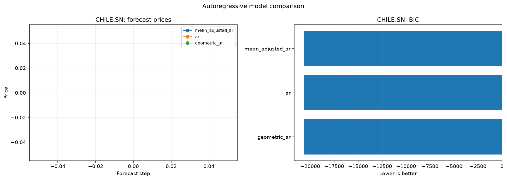

# Autoregressive Market Data Study

**Summary:** AR study for 2 ticker(s), horizon 10; 30 model/ticker comparison(s) have realized values.
**Companies:** COLBUN.SN, CHILE.SN  
**Origin:** 2024-01-02  
**Horizon:** 10  
**Selection criterion:** bic

## Forecasts

| ticker | model | step | timestamp | predicted_return | predicted_price | actual_price |
| --- | --- | --- | --- | --- | --- | --- |
| CHILE.SN | ar_1 | 1 | 2024-01-03 00:00:00+00:00 | 0.000752745482951512 | 88.49380166867938 | 87.7030029296875 |
| CHILE.SN | ar_1 | 2 | 2024-01-04 00:00:00+00:00 | 0.0005274943543396108 | 88.54048164945367 | 87.17073059082031 |
| CHILE.SN | ar_1 | 3 | 2024-01-05 00:00:00+00:00 | 0.0005298512207064874 | 88.58739493173758 | 86.90895080566406 |
| CHILE.SN | ar_1 | 4 | 2024-01-08 00:00:00+00:00 | 0.0005298265601460473 | 88.63433088646657 | 86.90895080566406 |
| CHILE.SN | ar_1 | 5 | 2024-01-09 00:00:00+00:00 | 0.000529826818176477 | 88.68129173198135 | 87.56338500976562 |
| CHILE.SN | ar_1 | 6 | 2024-01-10 00:00:00+00:00 | 0.0005298268154766315 | 88.72827745837205 | 86.71698760986328 |
| CHILE.SN | ar_1 | 7 | 2024-01-11 00:00:00+00:00 | 0.0005298268155048808 | 88.77528807906306 | 86.92640686035156 |
| CHILE.SN | ar_1 | 8 | 2024-01-12 00:00:00+00:00 | 0.0005298268155045851 | 88.82232360724149 | 87.25798797607422 |
| CHILE.SN | ar_1 | 9 | 2024-01-15 00:00:00+00:00 | 0.0005298268155045883 | 88.86938405610402 | 86.90895080566406 |
| CHILE.SN | ar_1 | 10 | 2024-01-16 00:00:00+00:00 | 0.0005298268155045883 | 88.91646943885432 | 86.12362670898438 |
| CHILE.SN | ar_10 | 1 | 2024-01-03 00:00:00+00:00 | 0.002921875103714095 | 88.68561181091466 | 87.7030029296875 |
| CHILE.SN | ar_10 | 2 | 2024-01-04 00:00:00+00:00 | -0.0009186799187114978 | 88.60413812026533 | 87.17073059082031 |
| CHILE.SN | ar_10 | 3 | 2024-01-05 00:00:00+00:00 | 0.0014397369360794154 | 88.73170477060657 | 86.90895080566406 |
| CHILE.SN | ar_10 | 4 | 2024-01-08 00:00:00+00:00 | -0.00104841281986195 | 88.63867731379686 | 86.90895080566406 |
| CHILE.SN | ar_10 | 5 | 2024-01-09 00:00:00+00:00 | -0.0017116818194921205 | 88.48695610133501 | 87.56338500976562 |
| CHILE.SN | ar_10 | 6 | 2024-01-10 00:00:00+00:00 | 0.0005647891127378111 | 88.53693257076036 | 86.71698760986328 |
| CHILE.SN | ar_10 | 7 | 2024-01-11 00:00:00+00:00 | 0.0004528218867393952 | 88.57702403161318 | 86.92640686035156 |
| CHILE.SN | ar_10 | 8 | 2024-01-12 00:00:00+00:00 | 0.0005316649055539953 | 88.6241173267292 | 87.25798797607422 |
| CHILE.SN | ar_10 | 9 | 2024-01-15 00:00:00+00:00 | 0.0010031856167846695 | 88.71302376653162 | 86.90895080566406 |
| CHILE.SN | ar_10 | 10 | 2024-01-16 00:00:00+00:00 | 0.0025088937116303067 | 88.93559531399917 | 86.12362670898438 |
| CHILE.SN | ar_2 | 1 | 2024-01-03 00:00:00+00:00 | 0.0005059487701383984 | 88.47197811690324 | 87.7030029296875 |
| CHILE.SN | ar_2 | 2 | 2024-01-04 00:00:00+00:00 | 0.0016227749082939526 | 88.61554822307849 | 87.17073059082031 |
| CHILE.SN | ar_2 | 3 | 2024-01-05 00:00:00+00:00 | 0.0005215917723677149 | 88.6617693639355 | 86.90895080566406 |
| CHILE.SN | ar_2 | 4 | 2024-01-08 00:00:00+00:00 | 0.0004768394668310775 | 88.70404679476731 | 86.90895080566406 |
| CHILE.SN | ar_2 | 5 | 2024-01-09 00:00:00+00:00 | 0.0005336735876470051 | 88.75138580165908 | 87.56338500976562 |
| CHILE.SN | ar_2 | 6 | 2024-01-10 00:00:00+00:00 | 0.0005353239916551092 | 88.79889654777134 | 86.71698760986328 |
| CHILE.SN | ar_2 | 7 | 2024-01-11 00:00:00+00:00 | 0.0005323980884420665 | 88.84617291054913 | 86.92640686035156 |
| CHILE.SN | ar_2 | 8 | 2024-01-12 00:00:00+00:00 | 0.0005323465535443329 | 88.89346986449365 | 87.25798797607422 |
| CHILE.SN | ar_2 | 9 | 2024-01-15 00:00:00+00:00 | 0.0005324968074911565 | 88.9408053534033 | 86.90895080566406 |
| CHILE.SN | ar_2 | 10 | 2024-01-16 00:00:00+00:00 | 0.0005324977546797837 | 88.98816613255339 | 86.12362670898438 |
| CHILE.SN | ar_3 | 1 | 2024-01-03 00:00:00+00:00 | -3.300526811950708e-05 | 88.42431989964088 | 87.7030029296875 |
| CHILE.SN | ar_3 | 2 | 2024-01-04 00:00:00+00:00 | 0.0012890996004546924 | 88.53830765509397 | 87.17073059082031 |
| CHILE.SN | ar_3 | 3 | 2024-01-05 00:00:00+00:00 | 0.00206090301368652 | 88.72077652016705 | 86.90895080566406 |
| CHILE.SN | ar_3 | 4 | 2024-01-08 00:00:00+00:00 | 0.0005131608417608617 | 88.76630454852781 | 86.90895080566406 |
| CHILE.SN | ar_3 | 5 | 2024-01-09 00:00:00+00:00 | 0.0004024005036583141 | 88.80202415418603 | 87.56338500976562 |
| CHILE.SN | ar_3 | 6 | 2024-01-10 00:00:00+00:00 | 0.000430312791839325 | 88.8402368011208 | 86.71698760986328 |
| CHILE.SN | ar_3 | 7 | 2024-01-11 00:00:00+00:00 | 0.0005451609048793265 | 88.88866902500497 | 86.92640686035156 |
| CHILE.SN | ar_3 | 8 | 2024-01-12 00:00:00+00:00 | 0.0005498249528001904 | 88.93754223325612 | 87.25798797607422 |
| CHILE.SN | ar_3 | 9 | 2024-01-15 00:00:00+00:00 | 0.0005417814213065395 | 88.98572694129476 | 86.90895080566406 |
| CHILE.SN | ar_3 | 10 | 2024-01-16 00:00:00+00:00 | 0.0005335340190942875 | 89.03320385383178 | 86.12362670898438 |
| CHILE.SN | ar_4 | 1 | 2024-01-03 00:00:00+00:00 | 4.1906171580214095e-05 | 88.43094411138291 | 87.7030029296875 |
| CHILE.SN | ar_4 | 2 | 2024-01-04 00:00:00+00:00 | 0.0012095371130149907 | 88.53790462022458 | 87.17073059082031 |
| CHILE.SN | ar_4 | 3 | 2024-01-05 00:00:00+00:00 | 0.0020129553982903264 | 88.71612747328318 | 86.90895080566406 |
| CHILE.SN | ar_4 | 4 | 2024-01-08 00:00:00+00:00 | 0.0007394325051057469 | 88.78172706166403 | 86.90895080566406 |
| CHILE.SN | ar_4 | 5 | 2024-01-09 00:00:00+00:00 | 0.00041345657685953007 | 88.81843445062262 | 87.56338500976562 |
| CHILE.SN | ar_4 | 6 | 2024-01-10 00:00:00+00:00 | 0.0004163771044649857 | 88.85541641318228 | 86.71698760986328 |
| CHILE.SN | ar_4 | 7 | 2024-01-11 00:00:00+00:00 | 0.0005155870764333827 | 88.90122911755601 | 86.92640686035156 |
| CHILE.SN | ar_4 | 8 | 2024-01-12 00:00:00+00:00 | 0.0005505407567387315 | 88.9501728675094 | 87.25798797607422 |
| CHILE.SN | ar_4 | 9 | 2024-01-15 00:00:00+00:00 | 0.000547995203308478 | 88.99891713557425 | 86.90895080566406 |
| CHILE.SN | ar_4 | 10 | 2024-01-16 00:00:00+00:00 | 0.0005391039227091413 | 89.0468968009189 | 86.12362670898438 |
| CHILE.SN | ar_5 | 1 | 2024-01-03 00:00:00+00:00 | 0.0005696890898641871 | 88.47761449735542 | 87.7030029296875 |
| CHILE.SN | ar_5 | 2 | 2024-01-04 00:00:00+00:00 | 0.0008324120737778235 | 88.55126433192208 | 87.17073059082031 |
| CHILE.SN | ar_5 | 3 | 2024-01-05 00:00:00+00:00 | 0.0024016658551001104 | 88.763934879894 | 86.90895080566406 |
| CHILE.SN | ar_5 | 4 | 2024-01-08 00:00:00+00:00 | 0.0009813468645603215 | 88.85104308907441 | 86.90895080566406 |
| CHILE.SN | ar_5 | 5 | 2024-01-09 00:00:00+00:00 | -0.0007195140956513348 | 88.7871135111585 | 87.56338500976562 |
| CHILE.SN | ar_5 | 6 | 2024-01-10 00:00:00+00:00 | 0.0004074718093727662 | 88.82329175694987 | 86.71698760986328 |
| CHILE.SN | ar_5 | 7 | 2024-01-11 00:00:00+00:00 | 0.0005693897158951386 | 88.87386682580824 | 86.92640686035156 |
| CHILE.SN | ar_5 | 8 | 2024-01-12 00:00:00+00:00 | 0.0007257508701437448 | 88.9383671119901 | 87.25798797607422 |
| CHILE.SN | ar_5 | 9 | 2024-01-15 00:00:00+00:00 | 0.00057924441527514 | 88.98988416444342 | 86.90895080566406 |
| CHILE.SN | ar_5 | 10 | 2024-01-16 00:00:00+00:00 | 0.00046070200584399305 | 89.03088198257781 | 86.12362670898438 |
| CHILE.SN | ar_6 | 1 | 2024-01-03 00:00:00+00:00 | 0.00032922471382588006 | 88.4563508966333 | 87.7030029296875 |
| CHILE.SN | ar_6 | 2 | 2024-01-04 00:00:00+00:00 | 0.0005360802812921766 | 88.50377060210404 | 87.17073059082031 |
| CHILE.SN | ar_6 | 3 | 2024-01-05 00:00:00+00:00 | 0.0026143621001234354 | 88.73515150568419 | 86.90895080566406 |
| CHILE.SN | ar_6 | 4 | 2024-01-08 00:00:00+00:00 | 0.0007781300205229207 | 88.80419899094642 | 86.90895080566406 |
| CHILE.SN | ar_6 | 5 | 2024-01-09 00:00:00+00:00 | -0.0008690931125320159 | 88.72701987323946 | 87.56338500976562 |
| CHILE.SN | ar_6 | 6 | 2024-01-10 00:00:00+00:00 | 0.00100581937567246 | 88.81626322897364 | 86.71698760986328 |
| CHILE.SN | ar_6 | 7 | 2024-01-11 00:00:00+00:00 | 0.0005594635791380384 | 88.86595269348538 | 86.92640686035156 |
| CHILE.SN | ar_6 | 8 | 2024-01-12 00:00:00+00:00 | 0.0007147440139288549 | 88.92946910121513 | 87.25798797607422 |
| CHILE.SN | ar_6 | 9 | 2024-01-15 00:00:00+00:00 | 0.00046185388437020426 | 88.9705415219545 | 86.90895080566406 |
| CHILE.SN | ar_6 | 10 | 2024-01-16 00:00:00+00:00 | 0.0004335344805727791 | 89.0091133194595 | 86.12362670898438 |
| CHILE.SN | ar_7 | 1 | 2024-01-03 00:00:00+00:00 | 0.0004201781180267222 | 88.46439365499572 | 87.7030029296875 |
| CHILE.SN | ar_7 | 2 | 2024-01-04 00:00:00+00:00 | 0.0006255078967382804 | 88.51972883180709 | 87.17073059082031 |
| CHILE.SN | ar_7 | 3 | 2024-01-05 00:00:00+00:00 | 0.0027303116152654966 | 88.76141527561673 | 86.90895080566406 |
| CHILE.SN | ar_7 | 4 | 2024-01-08 00:00:00+00:00 | 0.000696502913592199 | 88.82323785997076 | 86.90895080566406 |
| CHILE.SN | ar_7 | 5 | 2024-01-09 00:00:00+00:00 | -0.0007885793310277793 | 88.75319369047942 | 87.56338500976562 |
| CHILE.SN | ar_7 | 6 | 2024-01-10 00:00:00+00:00 | 0.0010835750982961562 | 88.8493644410567 | 86.71698760986328 |
| CHILE.SN | ar_7 | 7 | 2024-01-11 00:00:00+00:00 | 0.00033859544359582063 | 88.87944843102281 | 86.92640686035156 |
| CHILE.SN | ar_7 | 8 | 2024-01-12 00:00:00+00:00 | 0.0007210182563250699 | 88.94353213595367 | 87.25798797607422 |
| CHILE.SN | ar_7 | 9 | 2024-01-15 00:00:00+00:00 | 0.0004667822716564107 | 88.98504939993325 | 86.90895080566406 |
| CHILE.SN | ar_7 | 10 | 2024-01-16 00:00:00+00:00 | 0.000487381007550347 | 89.0284190229667 | 86.12362670898438 |
| CHILE.SN | ar_8 | 1 | 2024-01-03 00:00:00+00:00 | 0.0002687070373689552 | 88.45099948562596 | 87.7030029296875 |
| CHILE.SN | ar_8 | 2 | 2024-01-04 00:00:00+00:00 | 0.0003085351005753414 | 88.47828972364825 | 87.17073059082031 |
| CHILE.SN | ar_8 | 3 | 2024-01-05 00:00:00+00:00 | 0.0024511015687913567 | 88.69515899839385 | 86.90895080566406 |
| CHILE.SN | ar_8 | 4 | 2024-01-08 00:00:00+00:00 | 0.00037748345320315677 | 88.72863995329496 | 86.90895080566406 |
| CHILE.SN | ar_8 | 5 | 2024-01-09 00:00:00+00:00 | -0.0005028980392002532 | 88.68401849424154 | 87.56338500976562 |
| CHILE.SN | ar_8 | 6 | 2024-01-10 00:00:00+00:00 | 0.0008404207251087489 | 88.75855038137003 | 86.71698760986328 |
| CHILE.SN | ar_8 | 7 | 2024-01-11 00:00:00+00:00 | 0.00016702709480505252 | 88.77337546417934 | 86.92640686035156 |
| CHILE.SN | ar_8 | 8 | 2024-01-12 00:00:00+00:00 | 0.0014626157469761138 | 88.90321680104547 | 87.25798797607422 |
| CHILE.SN | ar_8 | 9 | 2024-01-15 00:00:00+00:00 | 0.00047541041181841173 | 88.94548231595684 | 86.90895080566406 |
| CHILE.SN | ar_8 | 10 | 2024-01-16 00:00:00+00:00 | 0.0004946965041357671 | 88.9894833351172 | 86.12362670898438 |
| CHILE.SN | ar_9 | 1 | 2024-01-03 00:00:00+00:00 | -0.00024140380620824183 | 88.40589179241769 | 87.7030029296875 |
| CHILE.SN | ar_9 | 2 | 2024-01-04 00:00:00+00:00 | 7.891701663056234e-05 | 88.41286852165052 | 87.17073059082031 |
| CHILE.SN | ar_9 | 3 | 2024-01-05 00:00:00+00:00 | 0.002005204661472075 | 88.59015441774424 | 86.90895080566406 |
| CHILE.SN | ar_9 | 4 | 2024-01-08 00:00:00+00:00 | -7.502421698268478e-06 | 88.58948977704749 | 86.90895080566406 |
| CHILE.SN | ar_9 | 5 | 2024-01-09 00:00:00+00:00 | -0.0009899564422731412 | 88.501790040925 | 87.56338500976562 |
| CHILE.SN | ar_9 | 6 | 2024-01-10 00:00:00+00:00 | 0.0012358145326972958 | 88.61116183922731 | 86.71698760986328 |
| CHILE.SN | ar_9 | 7 | 2024-01-11 00:00:00+00:00 | -0.00018997651859668644 | 88.59432779919229 | 86.92640686035156 |
| CHILE.SN | ar_9 | 8 | 2024-01-12 00:00:00+00:00 | 0.0011874240724406588 | 88.69952683670276 | 87.25798797607422 |
| CHILE.SN | ar_9 | 9 | 2024-01-15 00:00:00+00:00 | 0.00160900868112571 | 88.84224514539477 | 86.90895080566406 |
| CHILE.SN | ar_9 | 10 | 2024-01-16 00:00:00+00:00 | 0.0005403268917631251 | 88.89024899957144 | 86.12362670898438 |
| CHILE.SN | geometric_ar_1 | 1 | 2024-01-03 00:00:00+00:00 | 0.0007535276950922887 | 88.49387083753889 | 87.7030029296875 |
| CHILE.SN | geometric_ar_1 | 2 | 2024-01-04 00:00:00+00:00 | 0.000527477924156199 | 88.54054940082882 | 87.17073059082031 |
| CHILE.SN | geometric_ar_1 | 3 | 2024-01-05 00:00:00+00:00 | 0.0005298514467510279 | 88.58746273902499 | 86.90895080566406 |
| CHILE.SN | geometric_ar_1 | 4 | 2024-01-08 00:00:00+00:00 | 0.0005298265247637822 | 88.63439872654564 | 86.90895080566406 |
| CHILE.SN | geometric_ar_1 | 5 | 2024-01-09 00:00:00+00:00 | 0.0005298267864446483 | 88.68135960519137 | 87.56338500976562 |
| CHILE.SN | geometric_ar_1 | 6 | 2024-01-10 00:00:00+00:00 | 0.0005298267836969992 | 88.72834536472487 | 86.71698760986328 |
| CHILE.SN | geometric_ar_1 | 7 | 2024-01-11 00:00:00+00:00 | 0.0005298267837258495 | 88.77535601857478 | 86.92640686035156 |
| CHILE.SN | geometric_ar_1 | 8 | 2024-01-12 00:00:00+00:00 | 0.0005298267837255465 | 88.8223915799282 | 87.25798797607422 |
| CHILE.SN | geometric_ar_1 | 9 | 2024-01-15 00:00:00+00:00 | 0.0005298267837255497 | 88.86945206198179 | 86.90895080566406 |
| CHILE.SN | geometric_ar_1 | 10 | 2024-01-16 00:00:00+00:00 | 0.0005298267837255497 | 88.91653747793923 | 86.12362670898438 |
| CHILE.SN | geometric_ar_10 | 1 | 2024-01-03 00:00:00+00:00 | 0.0007367537826727876 | 88.4923875667854 | 87.7030029296875 |
| CHILE.SN | geometric_ar_10 | 2 | 2024-01-04 00:00:00+00:00 | 0.0005322037860084847 | 88.53948355048136 | 87.17073059082031 |
| CHILE.SN | geometric_ar_10 | 3 | 2024-01-05 00:00:00+00:00 | 0.0005360493259457737 | 88.58694508095819 | 86.90895080566406 |
| CHILE.SN | geometric_ar_10 | 4 | 2024-01-08 00:00:00+00:00 | 0.0005359770297949526 | 88.63442564866129 | 86.90895080566406 |
| CHILE.SN | geometric_ar_10 | 5 | 2024-01-09 00:00:00+00:00 | 0.000535978388962588 | 88.6819317853271 | 87.56338500976562 |
| CHILE.SN | geometric_ar_10 | 6 | 2024-01-10 00:00:00+00:00 | 0.0005359783634102365 | 88.72946338198945 | 86.71698760986328 |
| CHILE.SN | geometric_ar_10 | 7 | 2024-01-11 00:00:00+00:00 | 0.0005359783638906206 | 88.77702045460181 | 86.92640686035156 |
| CHILE.SN | geometric_ar_10 | 8 | 2024-01-12 00:00:00+00:00 | 0.0005359783638815895 | 88.82460301677536 | 87.25798797607422 |
| CHILE.SN | geometric_ar_10 | 9 | 2024-01-15 00:00:00+00:00 | 0.0005359783638817592 | 88.87221108217274 | 86.90895080566406 |
| CHILE.SN | geometric_ar_10 | 10 | 2024-01-16 00:00:00+00:00 | 0.0005359783638817561 | 88.91984466446313 | 86.12362670898438 |
| CHILE.SN | geometric_ar_2 | 1 | 2024-01-03 00:00:00+00:00 | 0.000739980966370425 | 88.49267293772779 | 87.7030029296875 |
| CHILE.SN | geometric_ar_2 | 2 | 2024-01-04 00:00:00+00:00 | 0.0005287912287890583 | 88.53946708698936 | 87.17073059082031 |
| CHILE.SN | geometric_ar_2 | 3 | 2024-01-05 00:00:00+00:00 | 0.0005328641158649756 | 88.58664659183783 | 86.90895080566406 |
| CHILE.SN | geometric_ar_2 | 4 | 2024-01-08 00:00:00+00:00 | 0.0005328047380179301 | 88.6338459768671 | 86.90895080566406 |
| CHILE.SN | geometric_ar_2 | 5 | 2024-01-09 00:00:00+00:00 | 0.0005328056972009914 | 88.6810705949684 | 87.56338500976562 |
| CHILE.SN | geometric_ar_2 | 6 | 2024-01-10 00:00:00+00:00 | 0.0005328056823100541 | 88.72832037329474 | 86.71698760986328 |
| CHILE.SN | geometric_ar_2 | 7 | 2024-01-11 00:00:00+00:00 | 0.0005328056825447457 | 88.77559532659227 | 86.92640686035156 |
| CHILE.SN | geometric_ar_2 | 8 | 2024-01-12 00:00:00+00:00 | 0.0005328056825410681 | 88.82289546825325 | 87.25798797607422 |
| CHILE.SN | geometric_ar_2 | 9 | 2024-01-15 00:00:00+00:00 | 0.0005328056825411259 | 88.87022081169849 | 86.90895080566406 |
| CHILE.SN | geometric_ar_2 | 10 | 2024-01-16 00:00:00+00:00 | 0.000532805682541125 | 88.91757137035565 | 86.12362670898438 |
| CHILE.SN | geometric_ar_3 | 1 | 2024-01-03 00:00:00+00:00 | 0.0007451851368144867 | 88.49313312814866 | 87.7030029296875 |
| CHILE.SN | geometric_ar_3 | 2 | 2024-01-04 00:00:00+00:00 | 0.0005317444866028496 | 88.54018886379177 | 87.17073059082031 |
| CHILE.SN | geometric_ar_3 | 3 | 2024-01-05 00:00:00+00:00 | 0.000535927955497057 | 88.58764002618886 | 86.90895080566406 |
| CHILE.SN | geometric_ar_3 | 4 | 2024-01-08 00:00:00+00:00 | 0.0005358462040151292 | 88.63510937681954 | 86.90895080566406 |
| CHILE.SN | geometric_ar_3 | 5 | 2024-01-09 00:00:00+00:00 | 0.0005358476078486371 | 88.6826042881505 | 87.56338500976562 |
| CHILE.SN | geometric_ar_3 | 6 | 2024-01-10 00:00:00+00:00 | 0.0005358475823022089 | 88.73012464725058 | 86.71698760986328 |
| CHILE.SN | geometric_ar_3 | 7 | 2024-01-11 00:00:00+00:00 | 0.000535847582764332 | 88.77767047006118 | 86.92640686035156 |
| CHILE.SN | geometric_ar_3 | 8 | 2024-01-12 00:00:00+00:00 | 0.0005358475827560284 | 88.82524177018527 | 87.25798797607422 |
| CHILE.SN | geometric_ar_3 | 9 | 2024-01-15 00:00:00+00:00 | 0.0005358475827561783 | 88.87283856127556 | 86.90895080566406 |
| CHILE.SN | geometric_ar_3 | 10 | 2024-01-16 00:00:00+00:00 | 0.0005358475827561756 | 88.9204608569913 | 86.12362670898438 |
| CHILE.SN | geometric_ar_4 | 1 | 2024-01-03 00:00:00+00:00 | 0.000746562070946724 | 88.49325488663152 | 87.7030029296875 |
| CHILE.SN | geometric_ar_4 | 2 | 2024-01-04 00:00:00+00:00 | 0.0005331080604105243 | 88.54043135410355 | 87.17073059082031 |
| CHILE.SN | geometric_ar_4 | 3 | 2024-01-05 00:00:00+00:00 | 0.0005372917603266071 | 88.58800339832587 | 86.90895080566406 |
| CHILE.SN | geometric_ar_4 | 4 | 2024-01-08 00:00:00+00:00 | 0.0005372097594931813 | 88.63559373832545 | 86.90895080566406 |
| CHILE.SN | geometric_ar_4 | 5 | 2024-01-09 00:00:00+00:00 | 0.0005372113643133342 | 88.68320978656435 | 87.56338500976562 |
| CHILE.SN | geometric_ar_4 | 6 | 2024-01-10 00:00:00+00:00 | 0.0005372113348042399 | 88.73085141206852 | 86.71698760986328 |
| CHILE.SN | geometric_ar_4 | 7 | 2024-01-11 00:00:00+00:00 | 0.0005372113353633236 | 88.77851863124351 | 86.92640686035156 |
| CHILE.SN | geometric_ar_4 | 8 | 2024-01-12 00:00:00+00:00 | 0.0005372113353527437 | 88.82621145778805 | 87.25798797607422 |
| CHILE.SN | geometric_ar_4 | 9 | 2024-01-15 00:00:00+00:00 | 0.0005372113353529437 | 88.87392990545963 | 86.90895080566406 |
| CHILE.SN | geometric_ar_4 | 10 | 2024-01-16 00:00:00+00:00 | 0.0005372113353529399 | 88.92167398802222 | 86.12362670898438 |
| CHILE.SN | geometric_ar_5 | 1 | 2024-01-03 00:00:00+00:00 | 0.0007466565297517899 | 88.4932632393628 | 87.7030029296875 |
| CHILE.SN | geometric_ar_5 | 2 | 2024-01-04 00:00:00+00:00 | 0.0005332015948860824 | 88.5404479884587 | 87.17073059082031 |
| CHILE.SN | geometric_ar_5 | 3 | 2024-01-05 00:00:00+00:00 | 0.0005373853116228447 | 88.5880283246922 | 86.90895080566406 |
| CHILE.SN | geometric_ar_5 | 4 | 2024-01-08 00:00:00+00:00 | 0.0005373033107619703 | 88.63562696560494 | 86.90895080566406 |
| CHILE.SN | geometric_ar_5 | 5 | 2024-01-09 00:00:00+00:00 | 0.0005373049179819312 | 88.68325132388198 | 87.56338500976562 |
| CHILE.SN | geometric_ar_5 | 6 | 2024-01-10 00:00:00+00:00 | 0.0005373048865039026 | 88.73090126816935 | 86.71698760986328 |
| CHILE.SN | geometric_ar_5 | 7 | 2024-01-11 00:00:00+00:00 | 0.0005373048871018071 | 88.77857681505768 | 86.92640686035156 |
| CHILE.SN | geometric_ar_5 | 8 | 2024-01-12 00:00:00+00:00 | 0.0005373048870902773 | 88.82627797824932 | 87.25798797607422 |
| CHILE.SN | geometric_ar_5 | 9 | 2024-01-15 00:00:00+00:00 | 0.0005373048870904995 | 88.87400477150909 | 86.90895080566406 |
| CHILE.SN | geometric_ar_5 | 10 | 2024-01-16 00:00:00+00:00 | 0.0005373048870904953 | 88.92175720860813 | 86.12362670898438 |
| CHILE.SN | geometric_ar_6 | 1 | 2024-01-03 00:00:00+00:00 | 0.0007395705339593491 | 88.49263664432311 | 87.7030029296875 |
| CHILE.SN | geometric_ar_6 | 2 | 2024-01-04 00:00:00+00:00 | 0.0005261850418548949 | 88.53920014603966 | 87.17073059082031 |
| CHILE.SN | geometric_ar_6 | 3 | 2024-01-05 00:00:00+00:00 | 0.0005303673975001665 | 88.58615845119786 | 86.90895080566406 |
| CHILE.SN | geometric_ar_6 | 4 | 2024-01-08 00:00:00+00:00 | 0.000530285423329388 | 88.63313439973328 | 86.90895080566406 |
| CHILE.SN | geometric_ar_6 | 5 | 2024-01-09 00:00:00+00:00 | 0.000530287030023261 | 88.68013540133576 | 87.56338500976562 |
| CHILE.SN | geometric_ar_6 | 6 | 2024-01-10 00:00:00+00:00 | 0.0005302869985320308 | 88.72716132416714 | 86.71698760986328 |
| CHILE.SN | geometric_ar_6 | 7 | 2024-01-11 00:00:00+00:00 | 0.0005302869991490287 | 88.77421218428874 | 86.92640686035156 |
| CHILE.SN | geometric_ar_6 | 8 | 2024-01-12 00:00:00+00:00 | 0.0005302869991371224 | 88.8212879948687 | 87.25798797607422 |
| CHILE.SN | geometric_ar_6 | 9 | 2024-01-15 00:00:00+00:00 | 0.0005302869991373539 | 88.868388769139 | 86.90895080566406 |
| CHILE.SN | geometric_ar_6 | 10 | 2024-01-16 00:00:00+00:00 | 0.0005302869991373494 | 88.91551452033755 | 86.12362670898438 |
| CHILE.SN | geometric_ar_7 | 1 | 2024-01-03 00:00:00+00:00 | 0.0007417130888628097 | 88.49282610453646 | 87.7030029296875 |
| CHILE.SN | geometric_ar_7 | 2 | 2024-01-04 00:00:00+00:00 | 0.0005349147979894712 | 88.54016222673567 | 87.17073059082031 |
| CHILE.SN | geometric_ar_7 | 3 | 2024-01-05 00:00:00+00:00 | 0.0005388439655160649 | 88.58787155885736 | 86.90895080566406 |
| CHILE.SN | geometric_ar_7 | 4 | 2024-01-08 00:00:00+00:00 | 0.0005387693113330594 | 88.63559998540958 | 86.90895080566406 |
| CHILE.SN | geometric_ar_7 | 5 | 2024-01-09 00:00:00+00:00 | 0.0005387707297625376 | 88.68335425229667 | 87.56338500976562 |
| CHILE.SN | geometric_ar_7 | 6 | 2024-01-10 00:00:00+00:00 | 0.0005387707028123765 | 88.73113424539494 | 86.71698760986328 |
| CHILE.SN | geometric_ar_7 | 7 | 2024-01-11 00:00:00+00:00 | 0.0005387707033244298 | 88.77893998099911 | 86.92640686035156 |
| CHILE.SN | geometric_ar_7 | 8 | 2024-01-12 00:00:00+00:00 | 0.0005387707033147025 | 88.82677147293221 | 87.25798797607422 |
| CHILE.SN | geometric_ar_7 | 9 | 2024-01-15 00:00:00+00:00 | 0.0005387707033148859 | 88.87462873507187 | 86.90895080566406 |
| CHILE.SN | geometric_ar_7 | 10 | 2024-01-16 00:00:00+00:00 | 0.0005387707033148824 | 88.9225117813023 | 86.12362670898438 |
| CHILE.SN | geometric_ar_8 | 1 | 2024-01-03 00:00:00+00:00 | 0.0007428518052382203 | 88.49292679808094 | 87.7030029296875 |
| CHILE.SN | geometric_ar_8 | 2 | 2024-01-04 00:00:00+00:00 | 0.0005360426965593159 | 88.54036278518821 | 87.17073059082031 |
| CHILE.SN | geometric_ar_8 | 3 | 2024-01-05 00:00:00+00:00 | 0.0005399720696242151 | 88.5881721081266 | 86.90895080566406 |
| CHILE.SN | geometric_ar_8 | 4 | 2024-01-08 00:00:00+00:00 | 0.0005398974115359821 | 88.63600063294048 | 86.90895080566406 |
| CHILE.SN | geometric_ar_8 | 5 | 2024-01-09 00:00:00+00:00 | 0.0005398988300396585 | 88.68385510598159 | 87.56338500976562 |
| CHILE.SN | geometric_ar_8 | 6 | 2024-01-10 00:00:00+00:00 | 0.0005398988030880886 | 88.73173541320655 | 86.71698760986328 |
| CHILE.SN | geometric_ar_8 | 7 | 2024-01-11 00:00:00+00:00 | 0.0005398988036001684 | 88.7796415709975 | 86.92640686035156 |
| CHILE.SN | geometric_ar_8 | 8 | 2024-01-12 00:00:00+00:00 | 0.0005398988035904389 | 88.82757359326487 | 87.25798797607422 |
| CHILE.SN | geometric_ar_8 | 9 | 2024-01-15 00:00:00+00:00 | 0.0005398988035906238 | 88.87553149397374 | 86.90895080566406 |
| CHILE.SN | geometric_ar_8 | 10 | 2024-01-16 00:00:00+00:00 | 0.0005398988035906203 | 88.92351528709581 | 86.12362670898438 |
| CHILE.SN | geometric_ar_9 | 1 | 2024-01-03 00:00:00+00:00 | 0.0007368657191241227 | 88.49239746501665 | 87.7030029296875 |
| CHILE.SN | geometric_ar_9 | 2 | 2024-01-04 00:00:00+00:00 | 0.0005301134782633023 | 88.5393084776367 | 87.17073059082031 |
| CHILE.SN | geometric_ar_9 | 3 | 2024-01-05 00:00:00+00:00 | 0.0005340417708396579 | 88.58659216672501 | 86.90895080566406 |
| CHILE.SN | geometric_ar_9 | 4 | 2024-01-08 00:00:00+00:00 | 0.0005339671332807071 | 88.63389449539139 | 86.90895080566406 |
| CHILE.SN | geometric_ar_9 | 5 | 2024-01-09 00:00:00+00:00 | 0.0005339685513943272 | 88.68122220763954 | 87.56338500976562 |
| CHILE.SN | geometric_ar_9 | 6 | 2024-01-10 00:00:00+00:00 | 0.0005339685244501684 | 88.72857518900818 | 86.71698760986328 |
| CHILE.SN | geometric_ar_9 | 7 | 2024-01-11 00:00:00+00:00 | 0.0005339685249621074 | 88.77595345542385 | 86.92640686035156 |
| CHILE.SN | geometric_ar_9 | 8 | 2024-01-12 00:00:00+00:00 | 0.0005339685249523806 | 88.82335702034167 | 87.25798797607422 |
| CHILE.SN | geometric_ar_9 | 9 | 2024-01-15 00:00:00+00:00 | 0.0005339685249525654 | 88.87078589727116 | 86.90895080566406 |
| CHILE.SN | geometric_ar_9 | 10 | 2024-01-16 00:00:00+00:00 | 0.0005339685249525619 | 88.91824009972811 | 86.12362670898438 |
| CHILE.SN | mean_adjusted_ar_1 | 1 | 2024-01-03 00:00:00+00:00 | 0.000739638945081997 | 88.49264269372976 | 87.7030029296875 |
| CHILE.SN | mean_adjusted_ar_1 | 2 | 2024-01-04 00:00:00+00:00 | 0.0005145374921706539 | 88.53817547617695 | 87.17073059082031 |
| CHILE.SN | mean_adjusted_ar_1 | 3 | 2024-01-05 00:00:00+00:00 | 0.0005168926612539859 | 88.5839402093214 | 86.90895080566406 |
| CHILE.SN | mean_adjusted_ar_1 | 4 | 2024-01-08 00:00:00+00:00 | 0.0005168680198252465 | 88.62972641508571 | 86.90895080566406 |
| CHILE.SN | mean_adjusted_ar_1 | 5 | 2024-01-09 00:00:00+00:00 | 0.0005168682776411351 | 88.67553630912568 | 87.56338500976562 |
| CHILE.SN | mean_adjusted_ar_1 | 6 | 2024-01-10 00:00:00+00:00 | 0.0005168682749436848 | 88.72136988060748 | 86.71698760986328 |
| CHILE.SN | mean_adjusted_ar_1 | 7 | 2024-01-11 00:00:00+00:00 | 0.0005168682749719073 | 88.76722714201081 | 86.92640686035156 |
| CHILE.SN | mean_adjusted_ar_1 | 8 | 2024-01-12 00:00:00+00:00 | 0.0005168682749716121 | 88.81310810557773 | 87.25798797607422 |
| CHILE.SN | mean_adjusted_ar_1 | 9 | 2024-01-15 00:00:00+00:00 | 0.0005168682749716151 | 88.85901278355912 | 86.90895080566406 |
| CHILE.SN | mean_adjusted_ar_1 | 10 | 2024-01-16 00:00:00+00:00 | 0.0005168682749716151 | 88.90494118821225 | 86.12362670898438 |
| CHILE.SN | mean_adjusted_ar_10 | 1 | 2024-01-03 00:00:00+00:00 | 0.0028984806881483054 | 88.68354310735069 | 87.7030029296875 |
| CHILE.SN | mean_adjusted_ar_10 | 2 | 2024-01-04 00:00:00+00:00 | -0.0009416100978186625 | 88.60003778765046 | 87.17073059082031 |
| CHILE.SN | mean_adjusted_ar_10 | 3 | 2024-01-05 00:00:00+00:00 | 0.001418037584291384 | 88.72567597120299 | 86.90895080566406 |
| CHILE.SN | mean_adjusted_ar_10 | 4 | 2024-01-08 00:00:00+00:00 | -0.001068536290921989 | 88.63086936649118 | 86.90895080566406 |
| CHILE.SN | mean_adjusted_ar_10 | 5 | 2024-01-09 00:00:00+00:00 | -0.001731687331513001 | 88.47738841282825 | 87.56338500976562 |
| CHILE.SN | mean_adjusted_ar_10 | 6 | 2024-01-10 00:00:00+00:00 | 0.0005432951981492472 | 88.52545775309773 | 86.71698760986328 |
| CHILE.SN | mean_adjusted_ar_10 | 7 | 2024-01-11 00:00:00+00:00 | 0.00043209171006485447 | 88.56370886952254 | 86.92640686035156 |
| CHILE.SN | mean_adjusted_ar_10 | 8 | 2024-01-12 00:00:00+00:00 | 0.0005110207474357992 | 88.60896676222472 | 87.25798797607422 |
| CHILE.SN | mean_adjusted_ar_10 | 9 | 2024-01-15 00:00:00+00:00 | 0.000983609800913336 | 88.69612341038085 | 86.90895080566406 |
| CHILE.SN | mean_adjusted_ar_10 | 10 | 2024-01-16 00:00:00+00:00 | 0.002490468626400734 | 88.91701832301777 | 86.12362670898438 |
| CHILE.SN | mean_adjusted_ar_2 | 1 | 2024-01-03 00:00:00+00:00 | 0.000489322035786239 | 88.4705078606998 | 87.7030029296875 |
| CHILE.SN | mean_adjusted_ar_2 | 2 | 2024-01-04 00:00:00+00:00 | 0.0016063526057538279 | 88.6126226915342 | 87.17073059082031 |
| CHILE.SN | mean_adjusted_ar_2 | 3 | 2024-01-05 00:00:00+00:00 | 0.0005060316259351545 | 88.65746348107317 | 86.90895080566406 |
| CHILE.SN | mean_adjusted_ar_2 | 4 | 2024-01-08 00:00:00+00:00 | 0.00046125811802495833 | 88.69835745582732 | 86.90895080566406 |
| CHILE.SN | mean_adjusted_ar_2 | 5 | 2024-01-09 00:00:00+00:00 | 0.0005180476736801701 | 88.74430743356656 | 87.56338500976562 |
| CHILE.SN | mean_adjusted_ar_2 | 6 | 2024-01-10 00:00:00+00:00 | 0.000519699724994077 | 88.79042782573458 | 86.71698760986328 |
| CHILE.SN | mean_adjusted_ar_2 | 7 | 2024-01-11 00:00:00+00:00 | 0.0005167761181035125 | 88.83631259835111 | 86.92640686035156 |
| CHILE.SN | mean_adjusted_ar_2 | 8 | 2024-01-12 00:00:00+00:00 | 0.0005167244695718996 | 88.88221649485722 | 87.25798797607422 |
| CHILE.SN | mean_adjusted_ar_2 | 9 | 2024-01-15 00:00:00+00:00 | 0.0005168746055716585 | 88.92815745545033 | 86.90895080566406 |
| CHILE.SN | mean_adjusted_ar_2 | 10 | 2024-01-16 00:00:00+00:00 | 0.0005168755601005597 | 88.97412224664383 | 86.12362670898438 |
| CHILE.SN | mean_adjusted_ar_3 | 1 | 2024-01-03 00:00:00+00:00 | -5.3798879053334765e-05 | 88.4224811780483 | 87.7030029296875 |
| CHILE.SN | mean_adjusted_ar_3 | 2 | 2024-01-04 00:00:00+00:00 | 0.0012686140349594441 | 88.5346551786767 | 87.17073059082031 |
| CHILE.SN | mean_adjusted_ar_3 | 3 | 2024-01-05 00:00:00+00:00 | 0.0020415257210670704 | 88.71540095442977 | 86.90895080566406 |
| CHILE.SN | mean_adjusted_ar_3 | 4 | 2024-01-08 00:00:00+00:00 | 0.0004952349920609908 | 88.75933592531713 | 86.90895080566406 |
| CHILE.SN | mean_adjusted_ar_3 | 5 | 2024-01-09 00:00:00+00:00 | 0.00038437188069251116 | 88.79345251819575 | 87.56338500976562 |
| CHILE.SN | mean_adjusted_ar_3 | 6 | 2024-01-10 00:00:00+00:00 | 0.0004121289329295708 | 88.8300468690332 | 86.71698760986328 |
| CHILE.SN | mean_adjusted_ar_3 | 7 | 2024-01-11 00:00:00+00:00 | 0.0005268812398565993 | 88.87684975426409 | 86.92640686035156 |
| CHILE.SN | mean_adjusted_ar_3 | 8 | 2024-01-12 00:00:00+00:00 | 0.0005315623432739405 | 88.92409334078228 | 87.25798797607422 |
| CHILE.SN | mean_adjusted_ar_3 | 9 | 2024-01-15 00:00:00+00:00 | 0.0005235347626959909 | 88.9706481948874 | 86.90895080566406 |
| CHILE.SN | mean_adjusted_ar_3 | 10 | 2024-01-16 00:00:00+00:00 | 0.0005152930504246205 | 89.016494151594 | 86.12362670898438 |
| CHILE.SN | mean_adjusted_ar_4 | 1 | 2024-01-03 00:00:00+00:00 | 1.8517765085851673e-05 | 88.42887593918454 | 87.7030029296875 |
| CHILE.SN | mean_adjusted_ar_4 | 2 | 2024-01-04 00:00:00+00:00 | 0.001186524260947726 | 88.53379894585471 | 87.17073059082031 |
| CHILE.SN | mean_adjusted_ar_4 | 3 | 2024-01-05 00:00:00+00:00 | 0.0019911751152499784 | 88.71008524317423 | 86.90895080566406 |
| CHILE.SN | mean_adjusted_ar_4 | 4 | 2024-01-08 00:00:00+00:00 | 0.0007192894529265843 | 88.77389347185787 | 86.90895080566406 |
| CHILE.SN | mean_adjusted_ar_4 | 5 | 2024-01-09 00:00:00+00:00 | 0.0003934640532521687 | 88.80882280780628 | 87.56338500976562 |
| CHILE.SN | mean_adjusted_ar_4 | 6 | 2024-01-10 00:00:00+00:00 | 0.00039620278398500594 | 88.84400911064516 | 86.71698760986328 |
| CHILE.SN | mean_adjusted_ar_4 | 7 | 2024-01-11 00:00:00+00:00 | 0.0004952761518520339 | 88.88801142959258 | 86.92640686035156 |
| CHILE.SN | mean_adjusted_ar_4 | 8 | 2024-01-12 00:00:00+00:00 | 0.0005302120513795971 | 88.9351409244757 | 87.25798797607422 |
| CHILE.SN | mean_adjusted_ar_4 | 9 | 2024-01-15 00:00:00+00:00 | 0.0005276853355170849 | 88.9820706941537 | 86.90895080566406 |
| CHILE.SN | mean_adjusted_ar_4 | 10 | 2024-01-16 00:00:00+00:00 | 0.0005188065743201104 | 89.02823517742644 | 86.12362670898438 |
| CHILE.SN | mean_adjusted_ar_5 | 1 | 2024-01-03 00:00:00+00:00 | 0.0005460021739625706 | 88.47551992879451 | 87.7030029296875 |
| CHILE.SN | mean_adjusted_ar_5 | 2 | 2024-01-04 00:00:00+00:00 | 0.0008090976100826743 | 88.54710526051973 | 87.17073059082031 |
| CHILE.SN | mean_adjusted_ar_5 | 3 | 2024-01-05 00:00:00+00:00 | 0.0023795117931505244 | 88.75780414173647 | 86.90895080566406 |
| CHILE.SN | mean_adjusted_ar_5 | 4 | 2024-01-08 00:00:00+00:00 | 0.0009607638795000903 | 88.8430794339796 | 86.90895080566406 |
| CHILE.SN | mean_adjusted_ar_5 | 5 | 2024-01-09 00:00:00+00:00 | -0.0007399374194745052 | 88.77734111504505 | 87.56338500976562 |
| CHILE.SN | mean_adjusted_ar_5 | 6 | 2024-01-10 00:00:00+00:00 | 0.0003856251578214354 | 88.8115758912235 | 86.71698760986328 |
| CHILE.SN | mean_adjusted_ar_5 | 7 | 2024-01-11 00:00:00+00:00 | 0.0005474577277901489 | 88.86019647476238 | 86.92640686035156 |
| CHILE.SN | mean_adjusted_ar_5 | 8 | 2024-01-12 00:00:00+00:00 | 0.0007039234951328831 | 88.92274725484309 | 87.25798797607422 |
| CHILE.SN | mean_adjusted_ar_5 | 9 | 2024-01-15 00:00:00+00:00 | 0.000557598046585437 | 88.9723304050094 | 86.90895080566406 |
| CHILE.SN | mean_adjusted_ar_5 | 10 | 2024-01-16 00:00:00+00:00 | 0.0004390779735152452 | 89.01139619554256 | 86.12362670898438 |
| CHILE.SN | mean_adjusted_ar_6 | 1 | 2024-01-03 00:00:00+00:00 | 0.00031306155067945744 | 88.45492163275142 | 87.7030029296875 |
| CHILE.SN | mean_adjusted_ar_6 | 2 | 2024-01-04 00:00:00+00:00 | 0.0005201315359008806 | 88.50092982699826 | 87.17073059082031 |
| CHILE.SN | mean_adjusted_ar_6 | 3 | 2024-01-05 00:00:00+00:00 | 0.0025992161561621246 | 88.73096287363997 | 86.90895080566406 |
| CHILE.SN | mean_adjusted_ar_6 | 4 | 2024-01-08 00:00:00+00:00 | 0.0007640863032129727 | 88.79876098704261 | 86.90895080566406 |
| CHILE.SN | mean_adjusted_ar_6 | 5 | 2024-01-09 00:00:00+00:00 | -0.0008830217006519036 | 88.72034975410006 | 87.56338500976562 |
| CHILE.SN | mean_adjusted_ar_6 | 6 | 2024-01-10 00:00:00+00:00 | 0.000990929343099062 | 88.8082653520014 | 86.71698760986328 |
| CHILE.SN | mean_adjusted_ar_6 | 7 | 2024-01-11 00:00:00+00:00 | 0.000544981636215845 | 88.85666422576242 | 86.92640686035156 |
| CHILE.SN | mean_adjusted_ar_6 | 8 | 2024-01-12 00:00:00+00:00 | 0.0007003197494009468 | 88.9188923025856 | 87.25798797607422 |
| CHILE.SN | mean_adjusted_ar_6 | 9 | 2024-01-15 00:00:00+00:00 | 0.00044750812656394053 | 88.95868422949609 | 86.90895080566406 |
| CHILE.SN | mean_adjusted_ar_6 | 10 | 2024-01-16 00:00:00+00:00 | 0.00041914103038237456 | 88.99597046406551 | 86.12362670898438 |
| CHILE.SN | mean_adjusted_ar_7 | 1 | 2024-01-03 00:00:00+00:00 | 0.00039506430792509946 | 88.46217291012113 | 87.7030029296875 |
| CHILE.SN | mean_adjusted_ar_7 | 2 | 2024-01-04 00:00:00+00:00 | 0.0006006958294187451 | 88.51531176844955 | 87.17073059082031 |
| CHILE.SN | mean_adjusted_ar_7 | 3 | 2024-01-05 00:00:00+00:00 | 0.0027067420056551238 | 88.75489988095686 | 86.90895080566406 |
| CHILE.SN | mean_adjusted_ar_7 | 4 | 2024-01-08 00:00:00+00:00 | 0.0006746679740921744 | 88.81477996945029 | 86.90895080566406 |
| CHILE.SN | mean_adjusted_ar_7 | 5 | 2024-01-09 00:00:00+00:00 | -0.0008102582375312374 | 88.74281706236552 | 87.56338500976562 |
| CHILE.SN | mean_adjusted_ar_7 | 6 | 2024-01-10 00:00:00+00:00 | 0.0010603677139932046 | 88.83691708042727 | 86.71698760986328 |
| CHILE.SN | mean_adjusted_ar_7 | 7 | 2024-01-11 00:00:00+00:00 | 0.00031607381476485286 | 88.86499610370083 | 86.92640686035156 |
| CHILE.SN | mean_adjusted_ar_7 | 8 | 2024-01-12 00:00:00+00:00 | 0.0006983062881181657 | 88.92705108927363 | 87.25798797607422 |
| CHILE.SN | mean_adjusted_ar_7 | 9 | 2024-01-15 00:00:00+00:00 | 0.00044420178277255524 | 88.9665526439042 | 86.90895080566406 |
| CHILE.SN | mean_adjusted_ar_7 | 10 | 2024-01-16 00:00:00+00:00 | 0.00046474375542089125 | 89.00789929368676 | 86.12362670898438 |
| CHILE.SN | mean_adjusted_ar_8 | 1 | 2024-01-03 00:00:00+00:00 | 0.00024323395704148993 | 88.4487469714774 | 87.7030029296875 |
| CHILE.SN | mean_adjusted_ar_8 | 2 | 2024-01-04 00:00:00+00:00 | 0.0002833867359025356 | 88.47381217317631 | 87.17073059082031 |
| CHILE.SN | mean_adjusted_ar_8 | 3 | 2024-01-05 00:00:00+00:00 | 0.002427224961017516 | 88.68855801847943 | 86.90895080566406 |
| CHILE.SN | mean_adjusted_ar_8 | 4 | 2024-01-08 00:00:00+00:00 | 0.0003552940978542897 | 88.72006853969062 | 86.90895080566406 |
| CHILE.SN | mean_adjusted_ar_8 | 5 | 2024-01-09 00:00:00+00:00 | -0.0005248978232499485 | 88.67349956883555 | 87.56338500976562 |
| CHILE.SN | mean_adjusted_ar_8 | 6 | 2024-01-10 00:00:00+00:00 | 0.0008169247172198713 | 88.74593914239571 | 86.71698760986328 |
| CHILE.SN | mean_adjusted_ar_8 | 7 | 2024-01-11 00:00:00+00:00 | 0.00014425088438722915 | 88.75874082260277 | 86.92640686035156 |
| CHILE.SN | mean_adjusted_ar_8 | 8 | 2024-01-12 00:00:00+00:00 | 0.0014396974239389052 | 88.88652655311715 | 87.25798797607422 |
| CHILE.SN | mean_adjusted_ar_8 | 9 | 2024-01-15 00:00:00+00:00 | 0.0004535012537646406 | 88.92683670435176 | 86.90895080566406 |
| CHILE.SN | mean_adjusted_ar_8 | 10 | 2024-01-16 00:00:00+00:00 | 0.0004727058244400004 | 88.96887293801093 | 86.12362670898438 |
| CHILE.SN | mean_adjusted_ar_9 | 1 | 2024-01-03 00:00:00+00:00 | -0.0002606583709532822 | 88.40418916442945 | 87.7030029296875 |
| CHILE.SN | mean_adjusted_ar_9 | 2 | 2024-01-04 00:00:00+00:00 | 5.993703121237332e-05 | 88.40948784907471 | 87.17073059082031 |
| CHILE.SN | mean_adjusted_ar_9 | 3 | 2024-01-05 00:00:00+00:00 | 0.001987187260885653 | 88.5851740570698 | 86.90895080566406 |
| CHILE.SN | mean_adjusted_ar_9 | 4 | 2024-01-08 00:00:00+00:00 | -2.422073525952062e-05 | 88.58302845902105 | 86.90895080566406 |
| CHILE.SN | mean_adjusted_ar_9 | 5 | 2024-01-09 00:00:00+00:00 | -0.0010066078122812996 | 88.49386009053866 | 87.56338500976562 |
| CHILE.SN | mean_adjusted_ar_9 | 6 | 2024-01-10 00:00:00+00:00 | 0.0012180631684353682 | 88.60165120214761 | 86.71698760986328 |
| CHILE.SN | mean_adjusted_ar_9 | 7 | 2024-01-11 00:00:00+00:00 | -0.00020712319161729 | 88.58329974536805 | 86.92640686035156 |
| CHILE.SN | mean_adjusted_ar_9 | 8 | 2024-01-12 00:00:00+00:00 | 0.0011702032938735603 | 88.68696021451228 | 87.25798797607422 |
| CHILE.SN | mean_adjusted_ar_9 | 9 | 2024-01-15 00:00:00+00:00 | 0.0015925902076397431 | 88.82820219889524 | 86.90895080566406 |
| CHILE.SN | mean_adjusted_ar_9 | 10 | 2024-01-16 00:00:00+00:00 | 0.0005248418983896173 | 88.87482296116785 | 86.12362670898438 |

## Model comparison

| ticker | model | horizon | evaluated_steps | mae | rmse | mape | directional_accuracy |
| --- | --- | --- | --- | --- | --- | --- | --- |
| CHILE.SN | ar_1 | 10 | 10 | 1.6860063405414423 | 1.763504204167096 | 1.9403899479189135 | 0.3 |
| CHILE.SN | ar_2 | 10 | 10 | 1.748325900657538 | 1.8279380665608662 | 2.0120920173121384 | 0.3 |
| CHILE.SN | ar_3 | 10 | 10 | 1.774813152958511 | 1.8605232647562409 | 2.0426383391526866 | 0.4 |
| CHILE.SN | ar_4 | 10 | 10 | 1.7848789949379096 | 1.8707524794712498 | 2.0542116493613327 | 0.3 |
| CHILE.SN | ar_5 | 10 | 10 | 1.7898282048634784 | 1.8721993664181444 | 2.0598611355178478 | 0.3 |
| CHILE.SN | ar_6 | 10 | 10 | 1.7628851631156492 | 1.8483610086585611 | 2.028929566770049 | 0.3 |
| CHILE.SN | ar_7 | 10 | 10 | 1.7818802641263773 | 1.86712992393613 | 2.050771390923322 | 0.3 |
| CHILE.SN | ar_8 | 10 | 10 | 1.7218234850334369 | 1.8075807505020558 | 1.9817130748904972 | 0.3 |
| CHILE.SN | ar_9 | 10 | 10 | 1.594872506733445 | 1.6854654156520925 | 1.83582207286554 | 0.4 |
| CHILE.SN | ar_10 | 10 | 10 | 1.634480102401291 | 1.7103344562678795 | 1.881114780285844 | 0.3 |
| CHILE.SN | mean_adjusted_ar_1 | 10 | 10 | 1.6796700100867823 | 1.7567012651068799 | 1.9330967058510582 | 0.3 |
| CHILE.SN | mean_adjusted_ar_2 | 10 | 10 | 1.7405515441199058 | 1.8196016047146577 | 2.003143758486312 | 0.3 |
| CHILE.SN | mean_adjusted_ar_3 | 10 | 10 | 1.7654477962689554 | 1.8504762820489171 | 2.031859168223466 | 0.4 |
| CHILE.SN | mean_adjusted_ar_4 | 10 | 10 | 1.7743963641632163 | 1.8595050437027612 | 2.0421466028145026 | 0.3 |
| CHILE.SN | mean_adjusted_ar_5 | 10 | 10 | 1.7790115998917215 | 1.860618315398761 | 2.047411330346236 | 0.3 |
| CHILE.SN | mean_adjusted_ar_6 | 10 | 10 | 1.7555421545904266 | 1.840494354528357 | 2.0204779472980054 | 0.3 |
| CHILE.SN | mean_adjusted_ar_7 | 10 | 10 | 1.7704417699796964 | 1.8548791043427038 | 2.0376059052456643 | 0.3 |
| CHILE.SN | mean_adjusted_ar_8 | 10 | 10 | 1.7102621329598577 | 1.79519299715167 | 1.9684063652566877 | 0.3 |
| CHILE.SN | mean_adjusted_ar_9 | 10 | 10 | 1.5861695839685652 | 1.6761874957714862 | 1.8258054259116956 | 0.4 |
| CHILE.SN | mean_adjusted_ar_10 | 10 | 10 | 1.6239809661228122 | 1.6993752563278182 | 1.8690308313778203 | 0.3 |
| CHILE.SN | geometric_ar_1 | 10 | 10 | 1.6860743709739523 | 1.7635691944719445 | 1.9404681277313298 | 0.3 |
| CHILE.SN | geometric_ar_2 | 10 | 10 | 1.6859326436045805 | 1.7635976191547247 | 1.94030776345228 | 0.3 |
| CHILE.SN | geometric_ar_3 | 10 | 10 | 1.6876031886324157 | 1.7653700151556821 | 1.9422302574520316 | 0.3 |
| CHILE.SN | geometric_ar_4 | 10 | 10 | 1.6882698455993606 | 1.766086097720915 | 1.9429975933038852 | 0.3 |
| CHILE.SN | geometric_ar_5 | 10 | 10 | 1.6883155781055124 | 1.7661352219155217 | 1.9430502323569732 | 0.3 |
| CHILE.SN | geometric_ar_6 | 10 | 10 | 1.684884973289175 | 1.7624505901079566 | 1.9391015359146577 | 0.3 |
| CHILE.SN | geometric_ar_7 | 10 | 10 | 1.6884820240997116 | 1.766379962107463 | 1.9432428311634478 | 0.3 |
| CHILE.SN | geometric_ar_8 | 10 | 10 | 1.6890334686317232 | 1.7669723500310648 | 1.9438775551959473 | 0.3 |
| CHILE.SN | geometric_ar_9 | 10 | 10 | 1.6861346371643193 | 1.7638585205668575 | 1.9405409404312977 | 0.3 |
| CHILE.SN | geometric_ar_10 | 10 | 10 | 1.6869336129676753 | 1.764738670255473 | 1.9414609167660906 | 0.3 |

## Coefficients and lag weights

| ticker | model | p | mean_adjusted | kind | shared_beta | mean_return | intercept | lag | weight | aic | bic |
| --- | --- | --- | --- | --- | --- | --- | --- | --- | --- | --- | --- |
| CHILE.SN | ar | 1 | False | ordinary |  | 0.0005168682749716151 | 0.0005353705435623668 | 0 |  | -14465.148556088558 | -14454.200146475565 |
| CHILE.SN | ar | 1 | False | ordinary |  | 0.0005168682749716151 | 0.0005353705435623668 | 1 | -0.01046328327587374 | -14465.148556088558 | -14454.200146475565 |
| CHILE.SN | ar | 2 | False | ordinary |  | 0.0005168682749716151 | 0.000565716012475041 | 0 |  | -14458.656113204115 | -14442.235201878626 |
| CHILE.SN | ar | 2 | False | ordinary |  | 0.0005168682749716151 | 0.000565716012475041 | 1 | -0.011241499998663333 | -14458.656113204115 | -14442.235201878626 |
| CHILE.SN | ar | 2 | False | ordinary |  | 0.0005168682749716151 | 0.000565716012475041 | 2 | -0.051155013126781675 | -14458.656113204115 | -14442.235201878626 |
| CHILE.SN | ar | 3 | False | ordinary |  | 0.0005168682749716151 | 0.0006088960523404224 | 0 |  | -14456.431678025188 | -14434.539401673059 |
| CHILE.SN | ar | 3 | False | ordinary |  | 0.0005168682749716151 | 0.0006088960523404224 | 1 | -0.014909738395910616 | -14456.431678025188 | -14434.539401673059 |
| CHILE.SN | ar | 3 | False | ordinary |  | 0.0005168682749716151 | 0.0006088960523404224 | 2 | -0.05223978378892094 | -14456.431678025188 | -14434.539401673059 |
| CHILE.SN | ar | 3 | False | ordinary |  | 0.0005168682749716151 | 0.0006088960523404224 | 3 | -0.07073412085408057 | -14456.431678025188 | -14434.539401673059 |
| CHILE.SN | ar | 4 | False | ordinary |  | 0.0005168682749716151 | 0.0006178755317264751 | 0 |  | -14445.480660441208 | -14418.11815671752 |
| CHILE.SN | ar | 4 | False | ordinary |  | 0.0005168682749716151 | 0.0006178755317264751 | 1 | -0.015722345767158682 | -14445.480660441208 | -14418.11815671752 |
| CHILE.SN | ar | 4 | False | ordinary |  | 0.0005168682749716151 | 0.0006178755317264751 | 2 | -0.05283485898618959 | -14445.480660441208 | -14418.11815671752 |
| CHILE.SN | ar | 4 | False | ordinary |  | 0.0005168682749716151 | 0.0006178755317264751 | 3 | -0.07109758930520907 | -14445.480660441208 | -14418.11815671752 |
| CHILE.SN | ar | 4 | False | ordinary |  | 0.0005168682749716151 | 0.0006178755317264751 | 4 | -0.010593996271880438 | -14445.480660441208 | -14418.11815671752 |
| CHILE.SN | ar | 5 | False | ordinary |  | 0.0005168682749716151 | 0.000586470927753165 | 0 |  | -14439.299757645014 | -14406.468165175544 |
| CHILE.SN | ar | 5 | False | ordinary |  | 0.0005168682749716151 | 0.000586470927753165 | 1 | -0.015189186365318625 | -14439.299757645014 | -14406.468165175544 |
| CHILE.SN | ar | 5 | False | ordinary |  | 0.0005168682749716151 | 0.000586470927753165 | 2 | -0.04903742511888401 | -14439.299757645014 | -14406.468165175544 |
| CHILE.SN | ar | 5 | False | ordinary |  | 0.0005168682749716151 | 0.000586470927753165 | 3 | -0.06831587363338193 | -14439.299757645014 | -14406.468165175544 |
| CHILE.SN | ar | 5 | False | ordinary |  | 0.0005168682749716151 | 0.000586470927753165 | 4 | -0.009844149040841674 | -14439.299757645014 | -14406.468165175544 |
| CHILE.SN | ar | 5 | False | ordinary |  | 0.0005168682749716151 | 0.000586470927753165 | 5 | 0.053469623064682295 | -14439.299757645014 | -14406.468165175544 |
| CHILE.SN | ar | 6 | False | ordinary |  | 0.0005168682749716151 | 0.0005948535506995417 | 0 |  | -14430.233076424009 | -14391.9335348067 |
| CHILE.SN | ar | 6 | False | ordinary |  | 0.0005168682749716151 | 0.0005948535506995417 | 1 | -0.013581465779804113 | -14430.233076424009 | -14391.9335348067 |
| CHILE.SN | ar | 6 | False | ordinary |  | 0.0005168682749716151 | 0.0005948535506995417 | 2 | -0.049192063530571706 | -14430.233076424009 | -14391.9335348067 |
| CHILE.SN | ar | 6 | False | ordinary |  | 0.0005168682749716151 | 0.0005948535506995417 | 3 | -0.07014237883437535 | -14430.233076424009 | -14391.9335348067 |
| CHILE.SN | ar | 6 | False | ordinary |  | 0.0005168682749716151 | 0.0005948535506995417 | 4 | -0.011104722687107601 | -14430.233076424009 | -14391.9335348067 |
| CHILE.SN | ar | 6 | False | ordinary |  | 0.0005168682749716151 | 0.0005948535506995417 | 5 | 0.0536899285771584 | -14430.233076424009 | -14391.9335348067 |
| CHILE.SN | ar | 6 | False | ordinary |  | 0.0005168682749716151 | 0.0005948535506995417 | 6 | -0.02931860378996988 | -14430.233076424009 | -14391.9335348067 |
| CHILE.SN | ar | 7 | False | ordinary |  | 0.0005168682749716151 | 0.0005979147097986628 | 0 |  | -14420.134391921216 | -14376.368041727656 |
| CHILE.SN | ar | 7 | False | ordinary |  | 0.0005168682749716151 | 0.0005979147097986628 | 1 | -0.012828427892182094 | -14420.134391921216 | -14376.368041727656 |
| CHILE.SN | ar | 7 | False | ordinary |  | 0.0005168682749716151 | 0.0005979147097986628 | 2 | -0.04980636713983972 | -14420.134391921216 | -14376.368041727656 |
| CHILE.SN | ar | 7 | False | ordinary |  | 0.0005168682749716151 | 0.0005979147097986628 | 3 | -0.0701443992408978 | -14420.134391921216 | -14376.368041727656 |
| CHILE.SN | ar | 7 | False | ordinary |  | 0.0005168682749716151 | 0.0005979147097986628 | 4 | -0.010520457449368211 | -14420.134391921216 | -14376.368041727656 |
| CHILE.SN | ar | 7 | False | ordinary |  | 0.0005168682749716151 | 0.0005979147097986628 | 5 | 0.054044055199621466 | -14420.134391921216 | -14376.368041727656 |
| CHILE.SN | ar | 7 | False | ordinary |  | 0.0005168682749716151 | 0.0005979147097986628 | 6 | -0.029968986405269144 | -14420.134391921216 | -14376.368041727656 |
| CHILE.SN | ar | 7 | False | ordinary |  | 0.0005168682749716151 | 0.0005979147097986628 | 7 | 0.010990493254260868 | -14420.134391921216 | -14376.368041727656 |
| CHILE.SN | ar | 8 | False | ordinary |  | 0.0005168682749716151 | 0.0006186751682397086 | 0 |  | -14411.142117289819 | -14361.91010006672 |
| CHILE.SN | ar | 8 | False | ordinary |  | 0.0005168682749716151 | 0.0006186751682397086 | 1 | -0.012466053015809365 | -14411.142117289819 | -14361.91010006672 |
| CHILE.SN | ar | 8 | False | ordinary |  | 0.0005168682749716151 | 0.0006186751682397086 | 2 | -0.050802175538682944 | -14411.142117289819 | -14361.91010006672 |
| CHILE.SN | ar | 8 | False | ordinary |  | 0.0005168682749716151 | 0.0006186751682397086 | 3 | -0.06823592197388154 | -14411.142117289819 | -14361.91010006672 |
| CHILE.SN | ar | 8 | False | ordinary |  | 0.0005168682749716151 | 0.0006186751682397086 | 4 | -0.010893547501214903 | -14411.142117289819 | -14361.91010006672 |
| CHILE.SN | ar | 8 | False | ordinary |  | 0.0005168682749716151 | 0.0006186751682397086 | 5 | 0.05152354904369362 | -14411.142117289819 | -14361.91010006672 |
| CHILE.SN | ar | 8 | False | ordinary |  | 0.0005168682749716151 | 0.0006186751682397086 | 6 | -0.03174001787139492 | -14411.142117289819 | -14361.91010006672 |
| CHILE.SN | ar | 8 | False | ordinary |  | 0.0005168682749716151 | 0.0006186751682397086 | 7 | 0.010474807298212785 | -14411.142117289819 | -14361.91010006672 |
| CHILE.SN | ar | 8 | False | ordinary |  | 0.0005168682749716151 | 0.0006186751682397086 | 8 | -0.03558134269725912 | -14411.142117289819 | -14361.91010006672 |
| CHILE.SN | ar | 9 | False | ordinary |  | 0.0005168682749716151 | 0.0006437389564909201 | 0 |  | -14405.323178791637 | -14350.626637062316 |
| CHILE.SN | ar | 9 | False | ordinary |  | 0.0005168682749716151 | 0.0006437389564909201 | 1 | -0.01432849721336095 | -14405.323178791637 | -14350.626637062316 |
| CHILE.SN | ar | 9 | False | ordinary |  | 0.0005168682749716151 | 0.0006437389564909201 | 2 | -0.04990827323424264 | -14405.323178791637 | -14350.626637062316 |
| CHILE.SN | ar | 9 | False | ordinary |  | 0.0005168682749716151 | 0.0006437389564909201 | 3 | -0.0701508429939573 | -14405.323178791637 | -14350.626637062316 |
| CHILE.SN | ar | 9 | False | ordinary |  | 0.0005168682749716151 | 0.0006437389564909201 | 4 | -0.00810576976056717 | -14405.323178791637 | -14350.626637062316 |
| CHILE.SN | ar | 9 | False | ordinary |  | 0.0005168682749716151 | 0.0006437389564909201 | 5 | 0.0510464087412039 | -14405.323178791637 | -14350.626637062316 |
| CHILE.SN | ar | 9 | False | ordinary |  | 0.0005168682749716151 | 0.0006437389564909201 | 6 | -0.03530093476256918 | -14405.323178791637 | -14350.626637062316 |
| CHILE.SN | ar | 9 | False | ordinary |  | 0.0005168682749716151 | 0.0006437389564909201 | 7 | 0.007853527023528836 | -14405.323178791637 | -14350.626637062316 |
| CHILE.SN | ar | 9 | False | ordinary |  | 0.0005168682749716151 | 0.0006437389564909201 | 8 | -0.035751744348277284 | -14405.323178791637 | -14350.626637062316 |
| CHILE.SN | ar | 9 | False | ordinary |  | 0.0005168682749716151 | 0.0006437389564909201 | 9 | -0.05359270331207864 | -14405.323178791637 | -14350.626637062316 |
| CHILE.SN | ar | 10 | False | ordinary |  | 0.0005168682749716151 | 0.0007101164007948408 | 0 |  | -14411.62640635336 | -14351.466483619226 |
| CHILE.SN | ar | 10 | False | ordinary |  | 0.0005168682749716151 | 0.0007101164007948408 | 1 | -0.019675485792090556 | -14411.62640635336 | -14351.466483619226 |
| CHILE.SN | ar | 10 | False | ordinary |  | 0.0005168682749716151 | 0.0007101164007948408 | 2 | -0.05345107549417624 | -14411.62640635336 | -14351.466483619226 |
| CHILE.SN | ar | 10 | False | ordinary |  | 0.0005168682749716151 | 0.0007101164007948408 | 3 | -0.0694978729469148 | -14411.62640635336 | -14351.466483619226 |
| CHILE.SN | ar | 10 | False | ordinary |  | 0.0005168682749716151 | 0.0007101164007948408 | 4 | -0.011398291734856464 | -14411.62640635336 | -14351.466483619226 |
| CHILE.SN | ar | 10 | False | ordinary |  | 0.0005168682749716151 | 0.0007101164007948408 | 5 | 0.05614730512440969 | -14411.62640635336 | -14351.466483619226 |
| CHILE.SN | ar | 10 | False | ordinary |  | 0.0005168682749716151 | 0.0007101164007948408 | 6 | -0.03610288050671611 | -14411.62640635336 | -14351.466483619226 |
| CHILE.SN | ar | 10 | False | ordinary |  | 0.0005168682749716151 | 0.0007101164007948408 | 7 | 0.0008452418549250062 | -14411.62640635336 | -14351.466483619226 |
| CHILE.SN | ar | 10 | False | ordinary |  | 0.0005168682749716151 | 0.0007101164007948408 | 8 | -0.0407710256224663 | -14411.62640635336 | -14351.466483619226 |
| CHILE.SN | ar | 10 | False | ordinary |  | 0.0005168682749716151 | 0.0007101164007948408 | 9 | -0.055278259870005134 | -14411.62640635336 | -14351.466483619226 |
| CHILE.SN | ar | 10 | False | ordinary |  | 0.0005168682749716151 | 0.0007101164007948408 | 10 | -0.09944348818934869 | -14411.62640635336 | -14351.466483619226 |
| CHILE.SN | mean_adjusted_ar | 1 | True | ordinary |  | 0.0005168682749716151 | 0.0005168682749716151 | 0 |  | -14467.14744310792 | -14461.673238301424 |
| CHILE.SN | mean_adjusted_ar | 1 | True | ordinary |  | 0.0005168682749716151 | 0.0005168682749716151 | 1 | -0.010462700497360837 | -14467.14744310792 | -14461.673238301424 |
| CHILE.SN | mean_adjusted_ar | 2 | True | ordinary |  | 0.0005168682749716151 | 0.0005168682749716151 | 0 |  | -14460.654322346229 | -14449.707048129236 |
| CHILE.SN | mean_adjusted_ar | 2 | True | ordinary |  | 0.0005168682749716151 | 0.0005168682749716151 | 1 | -0.011239961072178617 | -14460.654322346229 | -14449.707048129236 |
| CHILE.SN | mean_adjusted_ar | 2 | True | ordinary |  | 0.0005168682749716151 | 0.0005168682749716151 | 2 | -0.051154439660427056 | -14460.654322346229 | -14449.707048129236 |
| CHILE.SN | mean_adjusted_ar | 3 | True | ordinary |  | 0.0005168682749716151 | 0.0005168682749716151 | 0 |  | -14458.428864916645 | -14442.009657652548 |
| CHILE.SN | mean_adjusted_ar | 3 | True | ordinary |  | 0.0005168682749716151 | 0.0005168682749716151 | 1 | -0.014907560137474615 | -14458.428864916645 | -14442.009657652548 |
| CHILE.SN | mean_adjusted_ar | 3 | True | ordinary |  | 0.0005168682749716151 | 0.0005168682749716151 | 2 | -0.05223806525772271 | -14458.428864916645 | -14442.009657652548 |
| CHILE.SN | mean_adjusted_ar | 3 | True | ordinary |  | 0.0005168682749716151 | 0.0005168682749716151 | 3 | -0.07073367275276515 | -14458.428864916645 | -14442.009657652548 |
| CHILE.SN | mean_adjusted_ar | 4 | True | ordinary |  | 0.0005168682749716151 | 0.0005168682749716151 | 0 |  | -14447.477105652077 | -14425.587102673126 |
| CHILE.SN | mean_adjusted_ar | 4 | True | ordinary |  | 0.0005168682749716151 | 0.0005168682749716151 | 1 | -0.015719504854611186 | -14447.477105652077 | -14425.587102673126 |
| CHILE.SN | mean_adjusted_ar | 4 | True | ordinary |  | 0.0005168682749716151 | 0.0005168682749716151 | 2 | -0.05283261311190404 | -14447.477105652077 | -14425.587102673126 |
| CHILE.SN | mean_adjusted_ar | 4 | True | ordinary |  | 0.0005168682749716151 | 0.0005168682749716151 | 3 | -0.07109593388613408 | -14447.477105652077 | -14425.587102673126 |
| CHILE.SN | mean_adjusted_ar | 4 | True | ordinary |  | 0.0005168682749716151 | 0.0005168682749716151 | 4 | -0.010593025333464382 | -14447.477105652077 | -14425.587102673126 |
| CHILE.SN | mean_adjusted_ar | 5 | True | ordinary |  | 0.0005168682749716151 | 0.0005168682749716151 | 0 |  | -14441.296105908108 | -14413.936445516882 |
| CHILE.SN | mean_adjusted_ar | 5 | True | ordinary |  | 0.0005168682749716151 | 0.0005168682749716151 | 1 | -0.0151860883949813 | -14441.296105908108 | -14413.936445516882 |
| CHILE.SN | mean_adjusted_ar | 5 | True | ordinary |  | 0.0005168682749716151 | 0.0005168682749716151 | 2 | -0.049034784645822636 | -14441.296105908108 | -14413.936445516882 |
| CHILE.SN | mean_adjusted_ar | 5 | True | ordinary |  | 0.0005168682749716151 | 0.0005168682749716151 | 3 | -0.06831389272346579 | -14441.296105908108 | -14413.936445516882 |
| CHILE.SN | mean_adjusted_ar | 5 | True | ordinary |  | 0.0005168682749716151 | 0.0005168682749716151 | 4 | -0.009841990087205401 | -14441.296105908108 | -14413.936445516882 |
| CHILE.SN | mean_adjusted_ar | 5 | True | ordinary |  | 0.0005168682749716151 | 0.0005168682749716151 | 5 | 0.05347013644472502 | -14441.296105908108 | -14413.936445516882 |
| CHILE.SN | mean_adjusted_ar | 6 | True | ordinary |  | 0.0005168682749716151 | 0.0005168682749716151 | 0 |  | -14432.231374194818 | -14399.403195665696 |
| CHILE.SN | mean_adjusted_ar | 6 | True | ordinary |  | 0.0005168682749716151 | 0.0005168682749716151 | 1 | -0.01357931526329725 | -14432.231374194818 | -14399.403195665696 |
| CHILE.SN | mean_adjusted_ar | 6 | True | ordinary |  | 0.0005168682749716151 | 0.0005168682749716151 | 2 | -0.04919011291980069 | -14432.231374194818 | -14399.403195665696 |
| CHILE.SN | mean_adjusted_ar | 6 | True | ordinary |  | 0.0005168682749716151 | 0.0005168682749716151 | 3 | -0.07014079981895495 | -14432.231374194818 | -14399.403195665696 |
| CHILE.SN | mean_adjusted_ar | 6 | True | ordinary |  | 0.0005168682749716151 | 0.0005168682749716151 | 4 | -0.01110305702538254 | -14432.231374194818 | -14399.403195665696 |
| CHILE.SN | mean_adjusted_ar | 6 | True | ordinary |  | 0.0005168682749716151 | 0.0005168682749716151 | 5 | 0.05369107664071189 | -14432.231374194818 | -14399.403195665696 |
| CHILE.SN | mean_adjusted_ar | 6 | True | ordinary |  | 0.0005168682749716151 | 0.0005168682749716151 | 6 | -0.029318608089736454 | -14432.231374194818 | -14399.403195665696 |
| CHILE.SN | mean_adjusted_ar | 7 | True | ordinary |  | 0.0005168682749716151 | 0.0005168682749716151 | 0 |  | -14422.13027718861 | -14383.834720769244 |
| CHILE.SN | mean_adjusted_ar | 7 | True | ordinary |  | 0.0005168682749716151 | 0.0005168682749716151 | 1 | -0.012825796476376768 | -14422.13027718861 | -14383.834720769244 |
| CHILE.SN | mean_adjusted_ar | 7 | True | ordinary |  | 0.0005168682749716151 | 0.0005168682749716151 | 2 | -0.04980326598215169 | -14422.13027718861 | -14383.834720769244 |
| CHILE.SN | mean_adjusted_ar | 7 | True | ordinary |  | 0.0005168682749716151 | 0.0005168682749716151 | 3 | -0.07014175258746358 | -14422.13027718861 | -14383.834720769244 |
| CHILE.SN | mean_adjusted_ar | 7 | True | ordinary |  | 0.0005168682749716151 | 0.0005168682749716151 | 4 | -0.010517593781400911 | -14422.13027718861 | -14383.834720769244 |
| CHILE.SN | mean_adjusted_ar | 7 | True | ordinary |  | 0.0005168682749716151 | 0.0005168682749716151 | 5 | 0.05404611085616171 | -14422.13027718861 | -14383.834720769244 |
| CHILE.SN | mean_adjusted_ar | 7 | True | ordinary |  | 0.0005168682749716151 | 0.0005168682749716151 | 6 | -0.029967722845738686 | -14422.13027718861 | -14383.834720769244 |
| CHILE.SN | mean_adjusted_ar | 7 | True | ordinary |  | 0.0005168682749716151 | 0.0005168682749716151 | 7 | 0.010990056337511501 | -14422.13027718861 | -14383.834720769244 |
| CHILE.SN | mean_adjusted_ar | 8 | True | ordinary |  | 0.0005168682749716151 | 0.0005168682749716151 | 0 |  | -14413.13788611839 | -14369.37609303119 |
| CHILE.SN | mean_adjusted_ar | 8 | True | ordinary |  | 0.0005168682749716151 | 0.0005168682749716151 | 1 | -0.012462533469042114 | -14413.13788611839 | -14369.37609303119 |
| CHILE.SN | mean_adjusted_ar | 8 | True | ordinary |  | 0.0005168682749716151 | 0.0005168682749716151 | 2 | -0.05079975103888227 | -14413.13788611839 | -14369.37609303119 |
| CHILE.SN | mean_adjusted_ar | 8 | True | ordinary |  | 0.0005168682749716151 | 0.0005168682749716151 | 3 | -0.06823311425209193 | -14413.13788611839 | -14369.37609303119 |
| CHILE.SN | mean_adjusted_ar | 8 | True | ordinary |  | 0.0005168682749716151 | 0.0005168682749716151 | 4 | -0.010890392758429682 | -14413.13788611839 | -14369.37609303119 |
| CHILE.SN | mean_adjusted_ar | 8 | True | ordinary |  | 0.0005168682749716151 | 0.0005168682749716151 | 5 | 0.05152590232716442 | -14413.13788611839 | -14369.37609303119 |
| CHILE.SN | mean_adjusted_ar | 8 | True | ordinary |  | 0.0005168682749716151 | 0.0005168682749716151 | 6 | -0.03173852044961906 | -14413.13788611839 | -14369.37609303119 |
| CHILE.SN | mean_adjusted_ar | 8 | True | ordinary |  | 0.0005168682749716151 | 0.0005168682749716151 | 7 | 0.010475675849661447 | -14413.13788611839 | -14369.37609303119 |
| CHILE.SN | mean_adjusted_ar | 8 | True | ordinary |  | 0.0005168682749716151 | 0.0005168682749716151 | 8 | -0.035582041815649265 | -14413.13788611839 | -14369.37609303119 |
| CHILE.SN | mean_adjusted_ar | 9 | True | ordinary |  | 0.0005168682749716151 | 0.0005168682749716151 | 0 |  | -14407.320757130106 | -14358.093869573717 |
| CHILE.SN | mean_adjusted_ar | 9 | True | ordinary |  | 0.0005168682749716151 | 0.0005168682749716151 | 1 | -0.014325824397916173 | -14407.320757130106 | -14358.093869573717 |
| CHILE.SN | mean_adjusted_ar | 9 | True | ordinary |  | 0.0005168682749716151 | 0.0005168682749716151 | 2 | -0.04990579377908297 | -14407.320757130106 | -14358.093869573717 |
| CHILE.SN | mean_adjusted_ar | 9 | True | ordinary |  | 0.0005168682749716151 | 0.0005168682749716151 | 3 | -0.07014927365043769 | -14407.320757130106 | -14358.093869573717 |
| CHILE.SN | mean_adjusted_ar | 9 | True | ordinary |  | 0.0005168682749716151 | 0.0005168682749716151 | 4 | -0.00810327353320966 | -14407.320757130106 | -14358.093869573717 |
| CHILE.SN | mean_adjusted_ar | 9 | True | ordinary |  | 0.0005168682749716151 | 0.0005168682749716151 | 5 | 0.05104837385539325 | -14407.320757130106 | -14358.093869573717 |
| CHILE.SN | mean_adjusted_ar | 9 | True | ordinary |  | 0.0005168682749716151 | 0.0005168682749716151 | 6 | -0.03529962314876363 | -14407.320757130106 | -14358.093869573717 |
| CHILE.SN | mean_adjusted_ar | 9 | True | ordinary |  | 0.0005168682749716151 | 0.0005168682749716151 | 7 | 0.007854331314347488 | -14407.320757130106 | -14358.093869573717 |
| CHILE.SN | mean_adjusted_ar | 9 | True | ordinary |  | 0.0005168682749716151 | 0.0005168682749716151 | 8 | -0.03575128596192663 | -14407.320757130106 | -14358.093869573717 |
| CHILE.SN | mean_adjusted_ar | 9 | True | ordinary |  | 0.0005168682749716151 | 0.0005168682749716151 | 9 | -0.05359355216350171 | -14407.320757130106 | -14358.093869573717 |
| CHILE.SN | mean_adjusted_ar | 10 | True | ordinary |  | 0.0005168682749716151 | 0.0005168682749716151 | 0 |  | -14413.622794405945 | -14358.931955556733 |
| CHILE.SN | mean_adjusted_ar | 10 | True | ordinary |  | 0.0005168682749716151 | 0.0005168682749716151 | 1 | -0.01967268797704353 | -14413.622794405945 | -14358.931955556733 |
| CHILE.SN | mean_adjusted_ar | 10 | True | ordinary |  | 0.0005168682749716151 | 0.0005168682749716151 | 2 | -0.053447992048385476 | -14413.622794405945 | -14358.931955556733 |
| CHILE.SN | mean_adjusted_ar | 10 | True | ordinary |  | 0.0005168682749716151 | 0.0005168682749716151 | 3 | -0.0694952202904407 | -14413.622794405945 | -14358.931955556733 |
| CHILE.SN | mean_adjusted_ar | 10 | True | ordinary |  | 0.0005168682749716151 | 0.0005168682749716151 | 4 | -0.01139590678125909 | -14413.622794405945 | -14358.931955556733 |
| CHILE.SN | mean_adjusted_ar | 10 | True | ordinary |  | 0.0005168682749716151 | 0.0005168682749716151 | 5 | 0.056149739928526725 | -14413.622794405945 | -14358.931955556733 |
| CHILE.SN | mean_adjusted_ar | 10 | True | ordinary |  | 0.0005168682749716151 | 0.0005168682749716151 | 6 | -0.03610101794929039 | -14413.622794405945 | -14358.931955556733 |
| CHILE.SN | mean_adjusted_ar | 10 | True | ordinary |  | 0.0005168682749716151 | 0.0005168682749716151 | 7 | 0.0008465386597222045 | -14413.622794405945 | -14358.931955556733 |
| CHILE.SN | mean_adjusted_ar | 10 | True | ordinary |  | 0.0005168682749716151 | 0.0005168682749716151 | 8 | -0.04077019939114265 | -14413.622794405945 | -14358.931955556733 |
| CHILE.SN | mean_adjusted_ar | 10 | True | ordinary |  | 0.0005168682749716151 | 0.0005168682749716151 | 9 | -0.055278089606086024 | -14413.622794405945 | -14358.931955556733 |
| CHILE.SN | mean_adjusted_ar | 10 | True | ordinary |  | 0.0005168682749716151 | 0.0005168682749716151 | 10 | -0.09944284872024609 | -14413.622794405945 | -14358.931955556733 |
| CHILE.SN | geometric_ar | 1 | False | geometric | -0.01050000000000001 | 0.0005168682749716151 | 0.000535389964954668 | 0 |  | -14465.148553712572 | -14454.20014409958 |
| CHILE.SN | geometric_ar | 1 | False | geometric | -0.01050000000000001 | 0.0005168682749716151 | 0.000535389964954668 | 1 | -0.01050000000000001 | -14465.148553712572 | -14454.20014409958 |
| CHILE.SN | geometric_ar | 2 | False | geometric | -0.009700000000000009 | 0.0005168682749716151 | 0.0005379237659751036 | 0 |  | -14456.022340302563 | -14445.07506608557 |
| CHILE.SN | geometric_ar | 2 | False | geometric | -0.009700000000000009 | 0.0005168682749716151 | 0.0005379237659751036 | 1 | -0.009700000000000009 | -14456.022340302563 | -14445.07506608557 |
| CHILE.SN | geometric_ar | 2 | False | geometric | -0.009700000000000009 | 0.0005168682749716151 | 0.0005379237659751036 | 2 | 9.409000000000018e-05 | -14456.022340302563 | -14445.07506608557 |
| CHILE.SN | geometric_ar | 3 | False | geometric | -0.00980000000000001 | 0.0005168682749716151 | 0.0005410479306007963 | 0 |  | -14446.919125911321 | -14435.972987735257 |
| CHILE.SN | geometric_ar | 3 | False | geometric | -0.00980000000000001 | 0.0005168682749716151 | 0.0005410479306007963 | 1 | -0.00980000000000001 | -14446.919125911321 | -14435.972987735257 |
| CHILE.SN | geometric_ar | 3 | False | geometric | -0.00980000000000001 | 0.0005168682749716151 | 0.0005410479306007963 | 2 | 9.60400000000002e-05 | -14446.919125911321 | -14435.972987735257 |
| CHILE.SN | geometric_ar | 3 | False | geometric | -0.00980000000000001 | 0.0005168682749716151 | 0.0005410479306007963 | 3 | -9.411920000000029e-07 | -14446.919125911321 | -14435.972987735257 |
| CHILE.SN | geometric_ar | 4 | False | geometric | -0.00980000000000001 | 0.0005168682749716151 | 0.0005424249133266963 | 0 |  | -14437.730251572602 | -14426.785250083127 |
| CHILE.SN | geometric_ar | 4 | False | geometric | -0.00980000000000001 | 0.0005168682749716151 | 0.0005424249133266963 | 1 | -0.00980000000000001 | -14437.730251572602 | -14426.785250083127 |
| CHILE.SN | geometric_ar | 4 | False | geometric | -0.00980000000000001 | 0.0005168682749716151 | 0.0005424249133266963 | 2 | 9.60400000000002e-05 | -14437.730251572602 | -14426.785250083127 |
| CHILE.SN | geometric_ar | 4 | False | geometric | -0.00980000000000001 | 0.0005168682749716151 | 0.0005424249133266963 | 3 | -9.411920000000029e-07 | -14437.730251572602 | -14426.785250083127 |
| CHILE.SN | geometric_ar | 4 | False | geometric | -0.00980000000000001 | 0.0005168682749716151 | 0.0005424249133266963 | 4 | 9.223681600000038e-09 | -14437.730251572602 | -14426.785250083127 |
| CHILE.SN | geometric_ar | 5 | False | geometric | -0.00980000000000001 | 0.0005168682749716151 | 0.0005425193730223262 | 0 |  | -14428.520443856341 | -14417.576579699851 |
| CHILE.SN | geometric_ar | 5 | False | geometric | -0.00980000000000001 | 0.0005168682749716151 | 0.0005425193730223262 | 1 | -0.00980000000000001 | -14428.520443856341 | -14417.576579699851 |
| CHILE.SN | geometric_ar | 5 | False | geometric | -0.00980000000000001 | 0.0005168682749716151 | 0.0005425193730223262 | 2 | 9.60400000000002e-05 | -14428.520443856341 | -14417.576579699851 |
| CHILE.SN | geometric_ar | 5 | False | geometric | -0.00980000000000001 | 0.0005168682749716151 | 0.0005425193730223262 | 3 | -9.411920000000029e-07 | -14428.520443856341 | -14417.576579699851 |
| CHILE.SN | geometric_ar | 5 | False | geometric | -0.00980000000000001 | 0.0005168682749716151 | 0.0005425193730223262 | 4 | 9.223681600000038e-09 | -14428.520443856341 | -14417.576579699851 |
| CHILE.SN | geometric_ar | 5 | False | geometric | -0.00980000000000001 | 0.0005168682749716151 | 0.0005425193730223262 | 5 | -9.039207968000047e-11 | -14428.520443856341 | -14417.576579699851 |
| CHILE.SN | geometric_ar | 6 | False | geometric | -0.00980000000000001 | 0.0005168682749716151 | 0.0005354333772236452 | 0 |  | -14419.881019037153 | -14408.93829286078 |
| CHILE.SN | geometric_ar | 6 | False | geometric | -0.00980000000000001 | 0.0005168682749716151 | 0.0005354333772236452 | 1 | -0.00980000000000001 | -14419.881019037153 | -14408.93829286078 |
| CHILE.SN | geometric_ar | 6 | False | geometric | -0.00980000000000001 | 0.0005168682749716151 | 0.0005354333772236452 | 2 | 9.60400000000002e-05 | -14419.881019037153 | -14408.93829286078 |
| CHILE.SN | geometric_ar | 6 | False | geometric | -0.00980000000000001 | 0.0005168682749716151 | 0.0005354333772236452 | 3 | -9.411920000000029e-07 | -14419.881019037153 | -14408.93829286078 |
| CHILE.SN | geometric_ar | 6 | False | geometric | -0.00980000000000001 | 0.0005168682749716151 | 0.0005354333772236452 | 4 | 9.223681600000038e-09 | -14419.881019037153 | -14408.93829286078 |
| CHILE.SN | geometric_ar | 6 | False | geometric | -0.00980000000000001 | 0.0005168682749716151 | 0.0005354333772236452 | 5 | -9.039207968000047e-11 | -14419.881019037153 | -14408.93829286078 |
| CHILE.SN | geometric_ar | 6 | False | geometric | -0.00980000000000001 | 0.0005168682749716151 | 0.0005354333772236452 | 6 | 8.858423808640055e-13 | -14419.881019037153 | -14408.93829286078 |
| CHILE.SN | geometric_ar | 7 | False | geometric | -0.009500000000000008 | 0.0005168682749716151 | 0.0005438408585219072 | 0 |  | -14411.504111399512 | -14400.562523851122 |
| CHILE.SN | geometric_ar | 7 | False | geometric | -0.009500000000000008 | 0.0005168682749716151 | 0.0005438408585219072 | 1 | -0.009500000000000008 | -14411.504111399512 | -14400.562523851122 |
| CHILE.SN | geometric_ar | 7 | False | geometric | -0.009500000000000008 | 0.0005168682749716151 | 0.0005438408585219072 | 2 | 9.025000000000016e-05 | -14411.504111399512 | -14400.562523851122 |
| CHILE.SN | geometric_ar | 7 | False | geometric | -0.009500000000000008 | 0.0005168682749716151 | 0.0005438408585219072 | 3 | -8.573750000000023e-07 | -14411.504111399512 | -14400.562523851122 |
| CHILE.SN | geometric_ar | 7 | False | geometric | -0.009500000000000008 | 0.0005168682749716151 | 0.0005438408585219072 | 4 | 8.14506250000003e-09 | -14411.504111399512 | -14400.562523851122 |
| CHILE.SN | geometric_ar | 7 | False | geometric | -0.009500000000000008 | 0.0005168682749716151 | 0.0005438408585219072 | 5 | -7.737809375000034e-11 | -14411.504111399512 | -14400.562523851122 |
| CHILE.SN | geometric_ar | 7 | False | geometric | -0.009500000000000008 | 0.0005168682749716151 | 0.0005438408585219072 | 6 | 7.350918906250039e-13 | -14411.504111399512 | -14400.562523851122 |
| CHILE.SN | geometric_ar | 7 | False | geometric | -0.009500000000000008 | 0.0005168682749716151 | 0.0005438408585219072 | 7 | -6.983372960937544e-15 | -14411.504111399512 | -14400.562523851122 |
| CHILE.SN | geometric_ar | 8 | False | geometric | -0.009500000000000008 | 0.0005168682749716151 | 0.0005449795748973176 | 0 |  | -14402.309788288254 | -14391.369340016454 |
| CHILE.SN | geometric_ar | 8 | False | geometric | -0.009500000000000008 | 0.0005168682749716151 | 0.0005449795748973176 | 1 | -0.009500000000000008 | -14402.309788288254 | -14391.369340016454 |
| CHILE.SN | geometric_ar | 8 | False | geometric | -0.009500000000000008 | 0.0005168682749716151 | 0.0005449795748973176 | 2 | 9.025000000000016e-05 | -14402.309788288254 | -14391.369340016454 |
| CHILE.SN | geometric_ar | 8 | False | geometric | -0.009500000000000008 | 0.0005168682749716151 | 0.0005449795748973176 | 3 | -8.573750000000023e-07 | -14402.309788288254 | -14391.369340016454 |
| CHILE.SN | geometric_ar | 8 | False | geometric | -0.009500000000000008 | 0.0005168682749716151 | 0.0005449795748973176 | 4 | 8.14506250000003e-09 | -14402.309788288254 | -14391.369340016454 |
| CHILE.SN | geometric_ar | 8 | False | geometric | -0.009500000000000008 | 0.0005168682749716151 | 0.0005449795748973176 | 5 | -7.737809375000034e-11 | -14402.309788288254 | -14391.369340016454 |
| CHILE.SN | geometric_ar | 8 | False | geometric | -0.009500000000000008 | 0.0005168682749716151 | 0.0005449795748973176 | 6 | 7.350918906250039e-13 | -14402.309788288254 | -14391.369340016454 |
| CHILE.SN | geometric_ar | 8 | False | geometric | -0.009500000000000008 | 0.0005168682749716151 | 0.0005449795748973176 | 7 | -6.983372960937544e-15 | -14402.309788288254 | -14391.369340016454 |
| CHILE.SN | geometric_ar | 8 | False | geometric | -0.009500000000000008 | 0.0005168682749716151 | 0.0005449795748973176 | 8 | 6.634204312890672e-17 | -14402.309788288254 | -14391.369340016454 |
| CHILE.SN | geometric_ar | 9 | False | geometric | -0.009500000000000008 | 0.0005168682749716151 | 0.00053899348878322 | 0 |  | -14393.506297066577 | -14382.566988720713 |
| CHILE.SN | geometric_ar | 9 | False | geometric | -0.009500000000000008 | 0.0005168682749716151 | 0.00053899348878322 | 1 | -0.009500000000000008 | -14393.506297066577 | -14382.566988720713 |
| CHILE.SN | geometric_ar | 9 | False | geometric | -0.009500000000000008 | 0.0005168682749716151 | 0.00053899348878322 | 2 | 9.025000000000016e-05 | -14393.506297066577 | -14382.566988720713 |
| CHILE.SN | geometric_ar | 9 | False | geometric | -0.009500000000000008 | 0.0005168682749716151 | 0.00053899348878322 | 3 | -8.573750000000023e-07 | -14393.506297066577 | -14382.566988720713 |
| CHILE.SN | geometric_ar | 9 | False | geometric | -0.009500000000000008 | 0.0005168682749716151 | 0.00053899348878322 | 4 | 8.14506250000003e-09 | -14393.506297066577 | -14382.566988720713 |
| CHILE.SN | geometric_ar | 9 | False | geometric | -0.009500000000000008 | 0.0005168682749716151 | 0.00053899348878322 | 5 | -7.737809375000034e-11 | -14393.506297066577 | -14382.566988720713 |
| CHILE.SN | geometric_ar | 9 | False | geometric | -0.009500000000000008 | 0.0005168682749716151 | 0.00053899348878322 | 6 | 7.350918906250039e-13 | -14393.506297066577 | -14382.566988720713 |
| CHILE.SN | geometric_ar | 9 | False | geometric | -0.009500000000000008 | 0.0005168682749716151 | 0.00053899348878322 | 7 | -6.983372960937544e-15 | -14393.506297066577 | -14382.566988720713 |
| CHILE.SN | geometric_ar | 9 | False | geometric | -0.009500000000000008 | 0.0005168682749716151 | 0.00053899348878322 | 8 | 6.634204312890672e-17 | -14393.506297066577 | -14382.566988720713 |
| CHILE.SN | geometric_ar | 9 | False | geometric | -0.009500000000000008 | 0.0005168682749716151 | 0.00053899348878322 | 9 | -6.302494097246144e-19 | -14393.506297066577 | -14382.566988720713 |
| CHILE.SN | geometric_ar | 10 | False | geometric | -0.009400000000000009 | 0.0005168682749716151 | 0.0005409696424833893 | 0 |  | -14384.344697974868 | -14373.406530205026 |
| CHILE.SN | geometric_ar | 10 | False | geometric | -0.009400000000000009 | 0.0005168682749716151 | 0.0005409696424833893 | 1 | -0.009400000000000009 | -14384.344697974868 | -14373.406530205026 |
| CHILE.SN | geometric_ar | 10 | False | geometric | -0.009400000000000009 | 0.0005168682749716151 | 0.0005409696424833893 | 2 | 8.836000000000016e-05 | -14384.344697974868 | -14373.406530205026 |
| CHILE.SN | geometric_ar | 10 | False | geometric | -0.009400000000000009 | 0.0005168682749716151 | 0.0005409696424833893 | 3 | -8.305840000000024e-07 | -14384.344697974868 | -14373.406530205026 |
| CHILE.SN | geometric_ar | 10 | False | geometric | -0.009400000000000009 | 0.0005168682749716151 | 0.0005409696424833893 | 4 | 7.80748960000003e-09 | -14384.344697974868 | -14373.406530205026 |
| CHILE.SN | geometric_ar | 10 | False | geometric | -0.009400000000000009 | 0.0005168682749716151 | 0.0005409696424833893 | 5 | -7.339040224000036e-11 | -14384.344697974868 | -14373.406530205026 |
| CHILE.SN | geometric_ar | 10 | False | geometric | -0.009400000000000009 | 0.0005168682749716151 | 0.0005409696424833893 | 6 | 6.89869781056004e-13 | -14384.344697974868 | -14373.406530205026 |
| CHILE.SN | geometric_ar | 10 | False | geometric | -0.009400000000000009 | 0.0005168682749716151 | 0.0005409696424833893 | 7 | -6.484775941926444e-15 | -14384.344697974868 | -14373.406530205026 |
| CHILE.SN | geometric_ar | 10 | False | geometric | -0.009400000000000009 | 0.0005168682749716151 | 0.0005409696424833893 | 8 | 6.095689385410862e-17 | -14384.344697974868 | -14373.406530205026 |
| CHILE.SN | geometric_ar | 10 | False | geometric | -0.009400000000000009 | 0.0005168682749716151 | 0.0005409696424833893 | 9 | -5.729948022286216e-19 | -14384.344697974868 | -14373.406530205026 |
| CHILE.SN | geometric_ar | 10 | False | geometric | -0.009400000000000009 | 0.0005168682749716151 | 0.0005409696424833893 | 10 | 5.386151140949049e-21 | -14384.344697974868 | -14373.406530205026 |

## Selected models

| ticker | selected_model | selected_p | selected_kind | best_ar_model | best_ar_p | best_ar_criterion_value | mean_adjusted | criterion | criterion_value | origin | last_price |
| --- | --- | --- | --- | --- | --- | --- | --- | --- | --- | --- | --- |
| CHILE.SN | mean_adjusted_ar_1 | 1 | ordinary | mean_adjusted_ar_1 | 1 | -14461.673238301424 | True | bic | -14461.673238301424 | 2024-01-02 00:00:00+00:00 | 88.42723846435547 |

## Errors

- **COLBUN.SN:** no stored history was found

## Model comparison graphs

Each graph contains at most six models for readability.

### CHILE.SN

